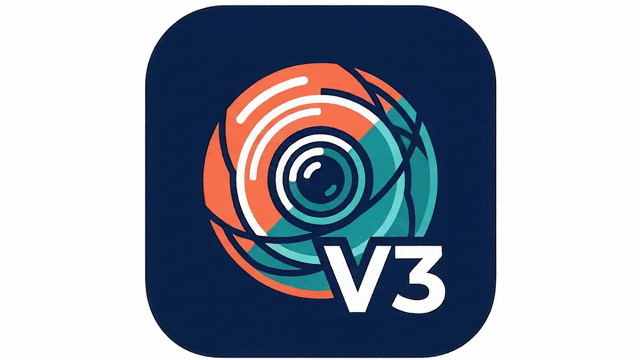

# Photosphere



**Photosphere** is a private photo and video archive backed by Google Cloud Storage and Firebase. It gives you:

- **A CLI (`photosphere`)** to organize, deduplicate, generate thumbnails, automatically tag and caption your photos with AI, translate tags/captions into other languages, and upload everything safely to your own cloud buckets.
- **A Web App** to browse your timeline, search by AI tags, captions, date, or map location, revisit "On This Day" memories, and organize albums from desktop or mobile.

---

## Table of Contents

- [Prerequisites](#prerequisites)
- [Quick Start](#quick-start)
- [Using the CLI](#using-the-cli)
  - [Supported Media Formats](#supported-media-formats)
  - [Global Options](#global-options)
  - [Commands Reference](#commands-reference)
- [Using the Web App](#using-the-web-app)
  - [Photos & Search](#photos--search)
  - [Media Viewer (Lightbox)](#media-viewer-lightbox)
  - [Memories](#memories)
  - [Albums](#albums)
  - [Settings & Admin Refresh](#settings--admin-refresh)
- [Common Workflows](#common-workflows)
- [Configuration, Cache & Environment Variables](#configuration-cache--environment-variables)
- [Using Docker (Last-Resort Alternative)](#using-docker-last-resort-alternative)
- [Troubleshooting](#troubleshooting)

---

## Prerequisites

Before you start, make sure you have:

1. **A Google Cloud / Firebase project** (the Firebase **Blaze** pay-as-you-go plan is required to link two storage buckets).
2. **Google Cloud CLI (`gcloud`)** installed and authenticated:
   ```bash
   gcloud auth login
   gcloud auth application-default login
   ```
3. **[`uv`](https://docs.astral.sh/uv/)** (Python 3.12+) for the CLI, and **[`pnpm`](https://pnpm.io/)** (Node.js) for the Web App.

---

## Quick Start

### 1. Install the CLI

Install the core CLI (fast, lightweight, no ML dependencies):

```bash
uv tool install ./cli
```

Or install **with local AI tagging, captioning, and translation** enabled:

```bash
uv tool install "./cli[ai]" --torch-backend=auto
```

### 2. Set Up Your Cloud Project

Run the interactive setup wizard:

```bash
photosphere init
```

The wizard will ask you for:
- Your **Firebase / GCP Project ID**
- Your preferred **GCS Bucket Location** (e.g., `europe-west8`)
- **Environment mode**:
  - `dev` — both buckets use `STANDARD` storage (good for testing and frequent access).
  - `prod` — media bucket uses low-cost `ARCHIVE` storage; database bucket uses `STANDARD`.
- **Allowed user email(s)** (comma-separated Google accounts allowed to sign in)
- **Admin email** (has permission to trigger database refreshes in the Web App)

It automatically creates your buckets, configures permissions/CORS, sets up Firebase, and writes `photosphere.config.json`.

### 3. Verify Your Setup

```bash
photosphere doctor
```

This checks your configuration file, Google Cloud credentials, photo/video libraries, cached AI models, and available compute device (`mps`, `cuda`, or `cpu`).

### 4. Upload Your First Photos & Videos

Preview what will be uploaded without changing anything:

```bash
photosphere ingest /path/to/your/photos --dry-run
```

When everything looks right, run the real upload:

```bash
photosphere ingest /path/to/your/photos
```

### 5. Open the Web App

Start the Web App locally:

```bash
make setup
make dev
```

Open **[http://localhost:3000](http://localhost:3000)** in your browser and sign in with one of the Google accounts you allowlisted during `photosphere init`.

---

## Using the CLI

### Supported Media Formats

| Type | Supported Extensions |
| :--- | :--- |
| **Images** | `.jpg`, `.jpeg`, `.png`, `.heic`, `.webp`, `.tif`, `.tiff` |
| **Videos** | `.mp4`, `.m4v`, `.mov`, `.avi`, `.mpg` |

- **Duplicates & unsupported files are never lost:** Exact duplicate files, unsupported file types, and filename collisions are moved safely into `./skipped/` and logged in `./skipped/skipped_manifest.json`.
- **Near-duplicate photos** automatically reuse existing AI tags and captions to save time.

### Global Options

These flags can be placed **before** any subcommand (`photosphere [GLOBAL OPTIONS] <command> ...`):

| Option | Description |
| :--- | :--- |
| `--profile <name>` | Active profile name (default: `default`, or `PHOTOSPHERE_PROFILE`). Isolates config, thumbnails, checkpoints, DB snapshots, and `skipped/` per profile while sharing AI models. |
| `-y`, `--yes` | Auto-confirm the active profile prompt (`Do you want to continue with profile "DEFAULT"?`). |
| `--config-file <path>` | Use a specific `photosphere.config.json` file. |
| `--creds <path>` | Use a specific Google Cloud JSON credentials file. |
| `-v`, `--verbose` | Enable detailed debug logging. |
| `--no-progress` | Hide progress bars. |

When running interactively, profile-scoped commands (`init`, `ingest`, `annotate`, `translate`, `verify-db`, `doctor`) first ask:

```text
Do you want to continue with profile "DEFAULT"? [Y/n]:
```

Pass `--yes` (or `-y`) to skip the prompt, or `--profile <name>` to run a separate ingestion concurrently on the same machine:

```bash
# Terminal 1 (default profile)
photosphere ingest /path/to/personal-photos

# Terminal 2 (isolated 'work' profile, sharing downloaded AI models)
photosphere --profile work init
photosphere --profile work ingest /path/to/work-photos
```

---

### Commands Reference

#### `photosphere init`
Provisions your Google Cloud & Firebase project and creates `photosphere.config.json`.

```bash
# Interactive setup
photosphere init

# Re-run setup even if photosphere.config.json already exists
photosphere init --force

# Non-interactive setup
photosphere init \
  --project-id my-gcp-project \
  --location europe-west8 \
  --mode prod \
  --allowed-emails "me@example.com,partner@example.com" \
  --admin-email "me@example.com" \
  --target-lang it \
  --non-interactive
```

| Option | Description |
| :--- | :--- |
| `--mode <dev\|prod>` | `dev` uses `STANDARD` for both buckets; `prod` uses `ARCHIVE` for media. |
| `--project-id <id>` | Existing GCP/Firebase Project ID. |
| `--location <region>` | GCS bucket region (default prompt: `europe-west8`). |
| `--media-bucket <name>` | Custom name for the media bucket. |
| `--data-bucket <name>` | Custom name for the database bucket. |
| `--media-storage-class <STANDARD\|ARCHIVE>` | Override media bucket storage class. |
| `--data-storage-class <STANDARD\|ARCHIVE>` | Override database bucket storage class. |
| `--allowed-emails <emails>` | Comma-separated list of allowed Google accounts. |
| `--admin-email <email>` | Admin Google account email. |
| `--target-lang <code>` | Default translation language code (default: `it`). |
| `--config-path <path>` | Custom output path for `photosphere.config.json`. |
| `--force` | Re-run provisioning if config already exists. |
| `--non-interactive` | Fail instead of prompting for missing options. |

---

#### `photosphere ingest <INPUT_DIR>`
Scans a local folder, generates thumbnails, deduplicates files, optionally runs AI tagging/captioning, and uploads everything to Google Cloud Storage.

```bash
# Preview planned uploads without modifying anything
photosphere ingest ~/Pictures/Trip --dry-run

# Preview including AI tags and captions in the JSON output
photosphere ingest ~/Pictures/Trip --dry-run --preview-ai

# Standard upload (organizes into result/YYYY/MM/DD/<file>)
photosphere ingest ~/Pictures/Trip

# Fast upload without AI (you can run `photosphere annotate` later)
photosphere ingest ~/Pictures/Trip --no-ai

# Keep your existing folder structure instead of date-based folders
photosphere ingest ~/Pictures/Trip --routing-mode preserve
```

| Option | Default | Description |
| :--- | :--- | :--- |
| `--routing-mode <chronological\|preserve>` | `chronological` | `chronological` stores files under `result/YYYY/MM/DD/<file>` (or `no_datetime/<file>`); `preserve` keeps the relative folder structure from `INPUT_DIR`. |
| `--commit-every <N>` | `100` | Saves progress to the cloud database every `N` uploaded files. |
| `--no-ai` | off | Skip AI tagging and captioning for faster uploads. |
| `--dry-run` | off | Preview planned cloud paths and collisions without uploading, moving files, or running AI. |
| `--preview-ai` | off | Run AI tagging/captioning during `--dry-run` and display the results. |
| `--init-db` | off | Initialize empty cloud databases if they do not exist yet. |
| `--device <auto\|cuda\|mps\|cpu>` | `auto` | Choose hardware device for local AI. |
| `--ai-provider <local\|remote>` | `local` | Use local AI model or a remote HTTP vision API. |
| `--ai-api-url <url>` | — | Base URL for the remote AI API (when `--ai-provider remote`). |
| `--offline` | off | Load AI models strictly from local cache without internet access to Hugging Face. |

---

#### `photosphere annotate`
Backfills AI tags and captions onto photos that are already in your cloud archive (for example, photos uploaded earlier with `--no-ai`).

```bash
# Check how many photos need AI tags/captions
photosphere annotate --dry-run

# Annotate using a local copy of your original photos (recommended — avoids GCS Archive retrieval fees)
photosphere annotate --local-media-dir ~/Pictures/Backup

# Annotate by downloading small thumbnails from your media bucket (much cheaper than full originals, but still incurs Archive retrieval fees if media_bucket is ARCHIVE)
photosphere annotate

# Process a limited batch (e.g., 50 photos at a time)
photosphere annotate --limit 50
```

| Option | Default | Description |
| :--- | :--- | :--- |
| `--local-media-dir <dir>` | — | Read original photos from a local folder first (avoids GCS downloads and Archive retrieval fees for matching images). |
| `--use-source-bucket` | off | Download full-size originals from `media_bucket` instead of `280×280` thumbnails when local originals are absent. **Warning:** incurs much higher Archive retrieval costs in `prod` mode. |
| `--include-partial` | off | Also process records missing only tags or only a caption. |
| `--commit-every <N>` | `100` | Save progress to GCS every `N` annotated items. |
| `--limit <N>` | unlimited | Maximum number of items to annotate in one run. |
| `--dry-run` | off | Count how many items need annotation without running AI or modifying GCS. |
| `--device`, `--ai-provider`, `--ai-api-url`, `--offline` | — | Same AI runtime options as `ingest`. |

---

#### `photosphere translate`
Translates all new English (`en`) tags and captions in your cloud database into another language so you can search and view them in that language in the Web App.

```bash
# Translate into Italian
photosphere translate --target-lang it

# Translate into Spanish using only locally cached models
photosphere translate --target-lang es --offline
```

| Option | Description |
| :--- | :--- |
| `--target-lang <code>` | **(Required)** Target ISO language code (e.g., `it`, `es`, `fr`, `de`). |
| `--offline` | Load translation models strictly from local cache. |

---

#### `photosphere prefetch-models`
Pre-downloads the AI vision model and translation models into your local cache so future `ingest`, `annotate`, and `translate` runs can work offline with `--offline`.

```bash
# Download vision model + Italian translation model (default)
photosphere prefetch-models

# Download vision model + multiple languages
photosphere prefetch-models --lang it --lang es --lang fr

# Download only translation models
photosphere prefetch-models --no-vision --lang de
```

| Option | Default | Description |
| :--- | :--- | :--- |
| `--lang <code>` | `it` | Translation language(s) to download (can be passed multiple times). |
| `--no-vision` | off | Skip downloading the vision AI model. |
| `--no-translate` | off | Skip downloading translation models. |
| `--cache-dir <dir>` | `~/.photosphere/cache` | Custom cache directory. |
| `--device <auto\|cuda\|mps\|cpu>` | `cpu` | Device used while verifying downloaded weights. |

---

#### `photosphere verify-db`
Downloads and checks all cloud databases and prints item counts.

```bash
photosphere verify-db
photosphere verify-db --lang it
```

---

#### `photosphere doctor` & `photosphere version`
- `photosphere doctor`: Checks config, credentials, media libraries, cached models, and compute device.
- `photosphere version`: Prints the installed CLI version.

---

## Using the Web App

Start the Web App (`make dev`) and visit `http://localhost:3000`. Sign in using an allowlisted Google account.

### Photos & Search

The **Photos** page (`/`) displays your media timeline.

- **Search by Tags or Captions:** Choose **Tags** or **Captions** from the dropdown next to the search bar, start typing to see autocomplete suggestions, and press **Enter** or click **Search**.
- **Filters:** Click **Filters** to refine your gallery by:
  - **Media Type:** All types, Images, Videos, or Files.
  - **Date Range:** Pick a **From date** and/or **To date**.
  - **Album Membership:** Check **Only show items not in any album** to find unorganized photos.
  - **Location (OpenStreetMap):** Search for any city or landmark, pick a match, and choose a search radius (**1, 5, 10, 25, 50, or 100 km**).
- **Bulk Add to Albums:** Click **Select** in the top-right header, tap multiple photos/videos, and use the bottom action bar to add them to an existing or new album.

### Media Viewer (Lightbox)

Click any photo or video to open the full-screen viewer:

- **Navigate:** Click the left/right arrows or use keyboard shortcuts:
  - `←` / `→` — Previous / Next item
  - `Esc` — Close viewer
- **Download Original:** Click the download icon in the top bar to save the original file.
- **Add to Album:** Click the folder-plus icon to add the current item to an album.
- **Details Drawer:** Click the **Info (`i`)** icon to view the filename, capture date, AI caption, AI labels, GPS coordinates, and SHA-1 hash.

### Memories

Open **Memories** (`/memories`) to view photos and videos captured **On This Day** in previous years.

> **Tip:** You can view memories for any date by adding `?date=MM-DD` to the URL—for example, `/memories?date=07-14`.

### Albums

Open **Albums** (`/albums`) to organize your collection:

- Click **New Album** to create an album.
- Rename or delete albums from the album cards (**deleting an album never deletes your photos or videos**).
- Open an album to browse its items, add more media, or remove items from the album.

### Settings & Admin Refresh

Open **Settings** (`/settings`) to configure your experience:

- **Appearance:** Switch between **Light** and **Dark** themes.
- **AI Labels & Captions Language:** Choose the language used for searching and displaying tags and captions (`English`, `Italiano`, `Español`, `Français`, `Deutsch`).
- **Account:** View your signed-in Google account, role (`Admin` / `Allowlisted User`), and **Sign out**.
- **Refresh Database (Admin only):** After uploading new media or running `photosphere translate` from the CLI, click **Refresh Database** so the Web App immediately loads the latest cloud data.

---

## Common Workflows

### Fast Upload Now, AI Tag Later
Great when importing thousands of photos quickly:

```bash
# 1. Upload quickly without waiting for AI
photosphere ingest ~/Pictures/Archive --no-ai

# 2. Run AI tagging overnight or in batches later
photosphere annotate --local-media-dir ~/Pictures/Archive --limit 500

# 3. Translate new tags & captions into your language
photosphere translate --target-lang it
```

### Fully Offline AI & Translation
Download models once, then run without contacting Hugging Face:

```bash
# 1. Pre-download models once
photosphere prefetch-models --lang it

# 2. Run ingest, annotate, or translate offline
photosphere ingest ~/Pictures/Trip --offline
photosphere translate --target-lang it --offline
```

### Using a Remote AI Server
If you run a remote Moondream-compatible HTTP endpoint:

```bash
export PHOTOSPHERE_AI_API_KEY="your-api-key"
photosphere ingest ~/Pictures/Trip \
  --ai-provider remote \
  --ai-api-url https://your-ai-endpoint.example.com
```

---

## Configuration, Cache & Environment Variables

### Where Photosphere Looks for `photosphere.config.json`
The CLI searches in this order and uses the first file it finds:
1. `--config-file <path>` flag
2. `PHOTOSPHERE_CONFIG_PATH` environment variable
3. `~/.photosphere/profiles/<profile>/photosphere.config.json`
4. When `--profile` is `default` (omitted): `./photosphere.config.json`, `../photosphere.config.json`, then legacy `~/.photosphere/photosphere.config.json`

### Shared vs. Profile-Scoped Directories (`~/.photosphere/`)
- **Shared across all profiles:** `~/.photosphere/cache/` (`huggingface/`, `easynmt/` AI weights) and `~/.photosphere/credentials.json`.
- **Isolated per profile (`~/.photosphere/profiles/<profile>/`):** `photosphere.config.json`, `cache/` (`thumbnails/`, `ingest_checkpoint.ndjson`, and `.json` DB snapshots), and `skipped/` (`skipped_manifest.json`).

### Where Photosphere Looks for Google Cloud Credentials
1. `--creds <path>` flag
2. `GOOGLE_APPLICATION_CREDENTIALS` environment variable
3. `~/.photosphere/credentials.json`
4. `gcloud` Application Default Credentials (`gcloud auth application-default login`)

### Useful Environment Variables

| Variable | Default | Description |
| :--- | :--- | :--- |
| `PHOTOSPHERE_PROFILE` | `default` | Active profile name for isolated ingestion state. |
| `PHOTOSPHERE_CONFIG_PATH` | *(auto-discovered)* | Path to `photosphere.config.json`. |
| `PHOTOSPHERE_MODELS_DIR` | `~/.photosphere/cache` | Shared cache for Hugging Face and EasyNMT AI models. |
| `PHOTOSPHERE_CACHE_DIR` | `~/.photosphere/profiles/<profile>/cache` | Per-profile cache for thumbnails, checkpoints, and DB snapshots. |
| `PHOTOSPHERE_SKIPPED_DIR` | `~/.photosphere/profiles/<profile>/skipped` | Per-profile folder where duplicates and unsupported files are moved. |
| `PHOTOSPHERE_AI_OFFLINE` | `0` | Set to `1` to always load AI/translation models strictly from local cache. |
| `PHOTOSPHERE_AI_MAX_IMAGE_SIZE` | `378` | Max image dimension (px) sent to local AI. Increase to `1024` for finer detail (slower). |
| `PHOTOSPHERE_AI_DTYPE` | `auto` | Local AI precision (`auto`, `float16`, `bfloat16`, `float32`). |
| `PHOTOSPHERE_AI_API_URL` | — | Default URL when using `--ai-provider remote`. |
| `PHOTOSPHERE_AI_API_KEY` | — | API key header sent to remote AI endpoints. |

---

## Using Docker (Last-Resort Alternative)

Running Photosphere natively with `uv` and `pnpm` is strongly recommended (especially for local GPU/Apple Silicon AI acceleration and simpler file paths).

Only use Docker as a fallback if you cannot install Python/`uv` or Node/`pnpm` on your machine:

### Run the CLI via Docker
Your local `MEDIA_DIR` is mounted inside the container at `/data/media`:

```bash
# Preview an upload
make cli-docker MEDIA_DIR=/path/to/your/photos ARGS="ingest /data/media --dry-run"

# Upload without AI
make cli-docker MEDIA_DIR=/path/to/your/photos ARGS="ingest /data/media --no-ai"

# Check database health
make cli-docker ARGS="verify-db"
```

### Run the Web App via Docker

```bash
docker compose --profile full up -d ssr
```

Then open **[http://localhost:3000](http://localhost:3000)**.

---

## Troubleshooting

| Issue | Solution |
| :--- | :--- |
| **`Missing photosphere.config.json`** | Run `photosphere init`, place your config in `~/.photosphere/photosphere.config.json`, or pass `--config-file <path>`. |
| **Google Cloud credentials error** | Run `gcloud auth application-default login` or pass `--creds /path/to/credentials.json`. Run `photosphere doctor` to verify. |
| **Newly uploaded photos don't appear in the Web App** | Open **Settings** (`/settings`) as an Admin user and click **Refresh Database**. |
| **AI commands say AI is not installed** | Reinstall the CLI with AI extras: `uv tool install "./cli[ai]" --torch-backend=auto`. |
| **Offline mode fails to find models** | Run `photosphere prefetch-models --lang <your-lang>` once while online. |
| **Want to avoid Archive retrieval fees during `annotate`** | Pass `--local-media-dir /path/to/local/photos` so images are read from disk instead of GCS. Without it, `annotate` downloads thumbnails from `media_bucket` (much smaller than `--use-source-bucket`, but still billed as Archive reads in `prod` mode). |
