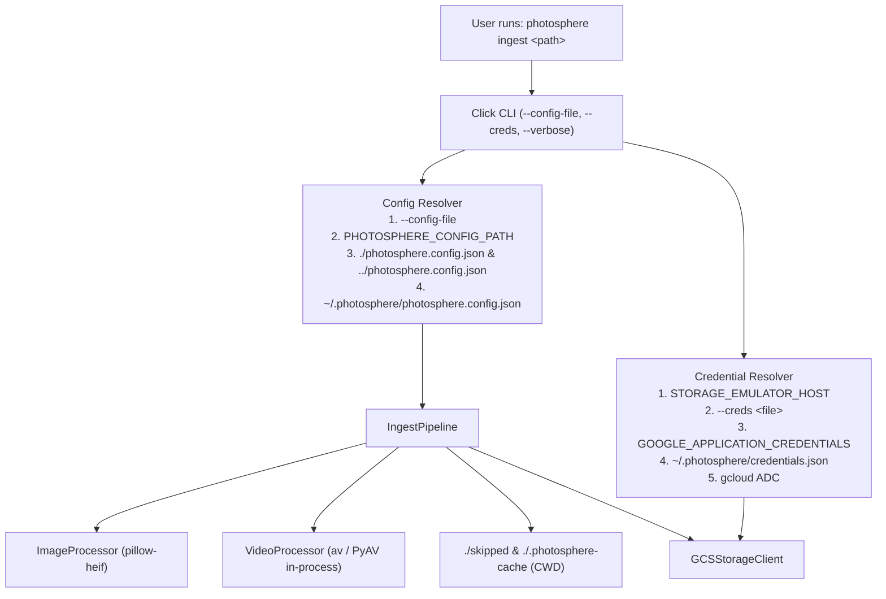

# Host-Native CLI Packaging and Cross-Platform Distribution

* **Author:** alessandro-candon
* **Date:** 2026-11-16
* **Status:** Feature Spec Approved (with Stage 8 Revisions)

## The Problem

Running the `photosphere` ingestion CLI today requires either:
1. **Host installation** inside a cloned repository with system-level native packages (`ffmpeg`, `ffprobe`, `libheif1`) manually installed on the machine—failing with `FileNotFoundError: 'ffprobe'` on a clean VM, or
2. **Docker execution** (`make cli-docker`), which bundles native binaries but forces users to manage container volume mounts (`MEDIA_DIR`), host UID/GID file permissions, and credential bind mounts, and cannot pass through Apple Silicon MPS GPUs inside the macOS Linux VM.

Additionally, runtime configuration (`photosphere.config.json`) is only searched near the current working directory (`./photosphere.config.json` and `../photosphere.config.json`), and a bug in `_PhotosphereJsonSource` causes explicit `--config-file` paths to be ignored. As a result, a user cannot install `photosphere` once and run `photosphere ingest <path>` from any folder on macOS, Linux, or Windows.

## Overview

This design moves `photosphere` from a repository-coupled or Docker-wrapped CLI to a host-native Python CLI installed and upgraded via `uv tool install`. By replacing `ffmpeg`/`ffprobe` subprocess calls with in-process `av` (PyAV) wheels—alongside `pillow-heif`, which already bundles `libheif`—Phase-1 ingestion (media scanning, metadata/thumbnail extraction, perceptual/SHA-1 hashing, `skipped/` deduplication, and GCS sync) runs with zero host system library setup on macOS, Linux, and Windows.

Phase-2 (`photosphere[ai]`) adds only optional AI tagging, captioning, and translation (`torch`, `transformers`, `timm`, `easynmt`) while preserving native CPU, CUDA, and Apple Silicon MPS access. To support running from any working directory, configuration lookup falls back to `~/.photosphere/photosphere.config.json` (with `--config-file` and `PHOTOSPHERE_CONFIG_PATH` overrides). Authentication relies on Google Application Default Credentials (`ADC`, via `gcloud auth application-default login`), `--creds <path>`, `GOOGLE_APPLICATION_CREDENTIALS`, or `~/.photosphere/credentials.json`, and `photosphere doctor` surfaces resolved paths, credentials, media backends, and compute device status.

*(Note: `make init` remains the admin-only, repository-local GCP bootstrap that provisions buckets/Firebase and generates `photosphere.config.json`; end-users only need `uv tool install` and that generated `photosphere.config.json` placed at `~/.photosphere/photosphere.config.json` or passed via `--config-file`.)*

## Goals

* **Zero host system media library setup:** Eliminate host `ffmpeg`, `ffprobe`, and `libheif` installation requirements across macOS, Linux, and Windows using prebuilt Python wheels (`av` and `pillow-heif`).
* **Package-managed install and upgrade:** Install and upgrade the CLI with `uv tool install` / `uv tool upgrade` (minimum `uv >= 0.6`), without maintaining custom shell/PowerShell bootstrap scripts or Docker wrappers as the primary UX.
* **Run from any directory:** Allow `photosphere ingest <path>` against any local folder without Docker volume-mapping or UID/GID permission workarounds.
* **Standard `gcloud` ADC authentication with explicit overrides:** Require `gcloud auth application-default login` (or `--creds <path>` / `GOOGLE_APPLICATION_CREDENTIALS` / `~/.photosphere/credentials.json`) and emit explicit remediation commands when credentials are missing or expired.
* **Preserve video hash parity & Phase-2 AI hardware acceleration:** Keep the pure-Python `photosphere` wheel under 5 MB (with `av` and `pillow-heif` wheels providing ~100 MB Phase-1 media support), ensure `av` video hashing reproduces legacy `videohash2` `0b...` hashes for existing libraries, and allow Phase-2 `photosphere[ai]` to use native CUDA (Linux/Windows), MPS (macOS), or CPU.
* **Diagnostic self-check:** Provide `photosphere doctor` and explicit startup/error messages for missing config, missing/expired credentials, media backend issues, and active compute device.

## Non-Goals

* **Desktop GUI application:** Out of scope; `photosphere` remains a terminal CLI.
* **Standalone single-file executable (PyInstaller/Nuitka):** Out of scope; multi-GB Phase-2 AI payloads make single-file executables impractical.
* **Built-in OAuth browser login (`photosphere auth login`):** Out of scope; users authenticate via `gcloud auth application-default login` or `--creds`.
* **Removing Docker support:** Existing `cli/Dockerfile` and `make cli-docker` remain for CI or server environments, but are not the primary end-user distribution path.
* **Moving `skipped/` or `.photosphere-cache/` out of CWD:** Both continue to default to `./skipped` and `./.photosphere-cache` in the current working directory (CWD) where `photosphere` is invoked.

## Technical Plan

### Architecture Overview

### Component Changes

1. **In-Process Video Processing & `videohash2` Parity (`cli/src/photosphere/media/video.py`, `cli/pyproject.toml`)**
   * Replace `ffmpeg-python` with `av` (PyAV), which ships prebuilt wheels bundling `libavformat`, `libavcodec`, `libavutil`, and `libswscale` for macOS, Linux, and Windows. Remove `videohash2` from `[project.optional-dependencies].ai` so all users share one deterministic `av` hashing path.
   * Replace `_run_ffprobe()` subprocess calls with `av.open(str(video_path))` metadata inspection (`creation_time`, `com.apple.quicktime.creationdate`, `location`, `com.apple.quicktime.location.ISO6709`), logging structured warnings on unreadable containers rather than failing on a missing binary.
   * Replace `_extract_first_frame_jpeg()` `ffmpeg` subprocess calls with `container.decode(video=0)`, respecting stream rotation / `DisplayMatrix` side data so portrait smartphone videos (`.mov`/`.mp4`) are oriented correctly before writing the `280x280` RGB JPEG (`quality=75`) thumbnail.
   * Replace `_compute_video_hash()` (`videohash2` + `ffmpeg` fallback) with an in-process `av` implementation using `container.seek()` that replicates `videohash2`'s exact frame-sampling, collage construction, and binary-prefixed (`0b...`) 64-bit perceptual hash algorithm, verified against golden test vectors from `videohash2` so previously ingested videos retain identical hashes.

2. **Config Discovery & Bug Fix (`cli/src/photosphere/config.py`)**
   * Fix `_PhotosphereJsonSource` (using `contextvars.ContextVar` for test isolation) so it reads from the explicit `config_path` passed to `PhotosphereSettings.require_runtime_config(config_path=...)` instead of re-calling `resolve_photosphere_config_path()` with no arguments.
   * Update `resolve_photosphere_config_path()` precedence:
     1. `--config-file` (`explicit_path` — raise `ConfigFileError` naming the missing path if it does not exist)
     2. `PHOTOSPHERE_CONFIG_PATH` (raise `ConfigFileError` if set to a non-existent path)
     3. `./photosphere.config.json` and `../photosphere.config.json`
     4. `~/.photosphere/photosphere.config.json`
   * Keep `skipped_dir` (`./skipped`) and `cache_dir` (`./.photosphere-cache`) defaulting to CWD.
   * Update the missing-config error message to reference `~/.photosphere/photosphere.config.json` and `--config-file` instead of only `make init`.

3. **Credential Resolution (`cli/src/photosphere/storage/gcs_client.py`)**
   * Preserve `STORAGE_EMULATOR_HOST` check first, then resolve credentials in strict order:
     1. `--creds <path>` (loaded via `google.auth.load_credentials_from_file` with explicit `scopes=["https://www.googleapis.com/auth/devstorage.read_write"]`)
     2. `GOOGLE_APPLICATION_CREDENTIALS`
     3. `~/.photosphere/credentials.json`
     4. Standard `gcloud` ADC (`google.auth.default()`)
   * Share this credential-source resolver between `GCSStorageClient` and `photosphere doctor`.
   * On `DefaultCredentialsError` or expired refresh tokens, raise an explicit CLI error instructing the user to run `gcloud auth application-default login` or pass `--creds <path>`.

4. **Root CLI Options & `photosphere doctor` (`cli/src/photosphere/main.py`)**
   * Add `--config-file`, `--creds`, and `--verbose` options on the root `cli` group (and configure `structlog` inside `cli()` rather than at import time so `--verbose` switches logging from `INFO` to `DEBUG`), passing `config_path` and `credentials_path` through Click `ctx.obj` to `ingest`, `translate`, `verify-db`, and `doctor`.
   * Add `photosphere doctor` (isolating errors per check and exiting non-zero on any failure) to report: resolved config path, target GCP project and buckets, active credential source (without printing secrets), `av` and `pillow-heif` availability, `skipped_dir`/`cache_dir` paths, and resolved compute device via `resolve_device()` in `cli/src/photosphere/ai/protocol.py`.

5. **Packaging & Phase-2 AI (`cli/pyproject.toml`, `README.md`, `cli/README.md`)**
   * Publish/install the CLI via `uv tool install` (and `uv tool upgrade`).
   * Keep Phase-2 AI (`torch`, `transformers`, `timm`, `easynmt` — tagging, captioning, and translation only) in `[project.optional-dependencies] ai` so Phase-1 remains lightweight and `uv tool install "photosphere[ai]" --torch-backend=auto` (or platform-specific PyTorch `--index-url`) preserves native CUDA, MPS, and CPU acceleration.

## Alternatives Considered

* **Docker wrapper (`make cli-docker` / shell script around `docker compose`):** Rejected: although Docker bundles `ffmpeg` and `libheif1`, it requires Docker Desktop on every user's machine, forces volume-mapping (`MEDIA_DIR`) and UID/GID permission workarounds for arbitrary folders, and cannot pass through Apple Silicon MPS GPUs inside the macOS Linux VM. Kept only as an optional CI/server container.
* **Standalone single-file executable (PyInstaller / Nuitka):** Rejected: bundling Phase-2 PyTorch, CUDA/MPS libraries, `transformers`, and `easynmt` creates multi-gigabyte executables with slow `/tmp` extraction on startup, complex per-OS/arch CI matrices, OS code-signing requirements, and antivirus false positives.
* **Custom `curl | sh` and PowerShell bootstrap scripts:** Rejected: maintaining custom cross-platform shell installers duplicates `uv`'s official installation flow while adding shell-quoting, Windows `ExecutionPolicy`, and `PATH` update bugs.
* **`static-ffmpeg` subprocess bundling instead of `av` (PyAV):** Rejected: `static-ffmpeg` downloads `ffmpeg`/`ffprobe` binaries lazily on first run (failing in offline environments and risking macOS Gatekeeper or Windows Defender blocks), whereas `av` ships `libav*` inside standard offline PyPI wheels.
* **Built-in `photosphere auth login` + `make init` OAuth provisioning:** Rejected: GCP provides no public REST API for personal/non-Workspace projects to create External OAuth Consent Screens or Desktop OAuth clients, and Testing-mode consent screens enforce a 7-day refresh token expiry. Standardizing on `gcloud auth application-default login` (with `--creds` fallback) avoids brittle OAuth client management.

## Detailed Implementation

1. **`cli/pyproject.toml`**
   * **What changes:** Replace `ffmpeg-python>=0.2.0` with `av>=13.0.0`, remove `videohash2>=3.0.1` from `[project.optional-dependencies].ai`, and update `[tool.mypy.overrides]` (replace `ffmpeg` with `av` if untyped).
   * **Why:** Bundles `libav*` inside cross-platform wheels and removes all `ffmpeg`/`ffprobe` subprocess dependencies across Phase-1 and Phase-2.

2. **`cli/src/photosphere/media/video.py`**
   * **What changes:** Replace `_run_ffprobe()`, `_extract_first_frame_jpeg()`, and `_compute_video_hash()` subprocess calls with `av.open(str(video_path))` in-process decoding and metadata inspection. Handle stream rotation / `DisplayMatrix` side data for thumbnails, use `container.seek()` for frame sampling, and replicate `videohash2`'s `0b...` 64-bit perceptual hash algorithm in `av`. Log structured warnings on container/decode errors instead of failing silently.
   * **Why:** Eliminates `FileNotFoundError: 'ffprobe'` and all `ffmpeg` subprocess dependencies while preserving `MediaMetadata` schema, field semantics, and legacy `videohash2` hash parity.

3. **`cli/src/photosphere/config.py`**
   * **What changes:** Update `resolve_photosphere_config_path()` to append `Path.home() / ".photosphere" / "photosphere.config.json"` as the final fallback after `--config-file`, `PHOTOSPHERE_CONFIG_PATH`, `./photosphere.config.json`, and `../photosphere.config.json` (raising `ConfigFileError` on missing explicit paths). Fix `_PhotosphereJsonSource` using `contextvars.ContextVar` to read from the explicit `config_path` passed to `require_runtime_config()`, keep `skipped_dir` (`./skipped`) and `cache_dir` (`./.photosphere-cache`) in CWD, and update the `ConfigFileError` message for standalone installs.
   * **Why:** Enables running `photosphere` from any directory while fixing the bug where `--config-file` was ignored by `_PhotosphereJsonSource`.

4. **`cli/src/photosphere/storage/gcs_client.py`**
   * **What changes:** Update `_build_storage_client()` and `GCSStorageClient.__init__()` to accept `credentials_path: Path | None = None`, extract a shared credential-source resolver helper (`STORAGE_EMULATOR_HOST` > `--creds <path>` with explicit scopes > `GOOGLE_APPLICATION_CREDENTIALS` > `~/.photosphere/credentials.json` > `google.auth.default()`), and catch `DefaultCredentialsError` / token-refresh errors to emit actionable guidance (`gcloud auth application-default login` or `--creds <path>`).
   * **Why:** Enforces deterministic credential precedence and surfaces clear remediation without duplicating resolution logic in `doctor`.

5. **`cli/src/photosphere/main.py`**
   * **What changes:** Add `--config-file`, `--creds`, and `--verbose` options to the root `cli` group, move `structlog.configure(...)` into `cli()` so `--verbose` controls log level, pass `config_path` and `credentials_path` via `ctx.obj` to `ingest`, `translate`, `verify-db`, and `doctor`, and add `photosphere doctor` reusing `resolve_photosphere_config_path()`, the shared credential resolver, and `resolve_device()` from `photosphere.ai.protocol`.
   * **Why:** Exposes global config/credential overrides, debug logging, and single-command environment diagnostics.

6. **`cli/Dockerfile`**
   * **What changes:** Remove `ffmpeg` and `libheif1` from `apt-get install` once `av` and `pillow-heif` wheels provide all media codecs in-process.
   * **Why:** Keeps the optional CI/server container aligned with the Python-only dependency footprint.

7. **Tests (`cli/tests/test_media_and_dedup.py`, `cli/tests/test_ingest_pipeline.py`)**
   * **What changes:** Update video tests to generate/probe synthetic containers with `av` (verifying `created_at`, GPS, `DisplayMatrix` rotation, `280x280` JPEG thumbnail, and golden-vector `0b...` hash parity with `videohash2` with no `ffprobe`/`ffmpeg` on `PATH`); add unit tests for `~/.photosphere/photosphere.config.json` fallback, `--config-file` override in `_PhotosphereJsonSource`, credential precedence, and `photosphere doctor`.
   * **Why:** Verifies cross-platform behavior, hash compatibility, and config/credential precedence.

8. **Documentation (`README.md`, `cli/README.md`)**
   * **What changes:** Document `uv tool install` / `uv tool upgrade` installation, `photosphere[ai]` installation, `gcloud auth application-default login` / `--creds`, `~/.photosphere/photosphere.config.json` setup from `make init`, and `photosphere doctor` (moving `make cli-docker` to an optional CI/headless section).
   * **Why:** Aligns user-facing setup docs with the host-native CLI workflow.
