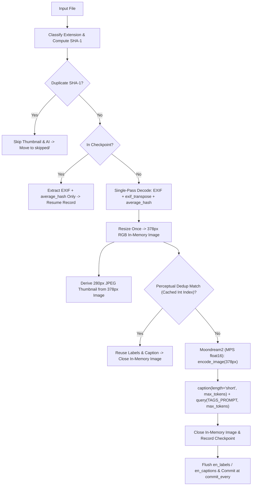

# Local Ingest Latency Reduction (macOS Metal & Cross-Platform PyTorch)

*   **Author:** alessandro-candon
*   **Status:** Draft
*   **Date:** 2026-11-20

--------------------------------------------------------------------------------

## Overview

`photosphere ingest` processes local photo and video folders, generates metadata and thumbnails, runs vision AI to produce captions and descriptive tags, and syncs results to Google Cloud Storage (GCS). On an Apple M2 Pro (16GB RAM, macOS Sequoia), local ingestion currently averages ~5 seconds per file before uploads, which makes importing large personal photo libraries slow compared to `photosphere-v2` (~0.5 seconds per image on the same machine).

This design defines how to reduce full local ingestion time (excluding uploads) to **<=2.5 seconds per file** on Apple M2 Pro while keeping a single shared PyTorch/Transformers `vikhyatk/moondream2` backend across macOS, Linux (CUDA/CPU), and Windows, preserving 100% offline execution, existing remote HTTP API (`x-api-key`) support, unchanged GCS and checkpoint schemas, and equivalent caption and tag quality.

## The Problem

Importing a folder of 1,000 photos at ~5 seconds per file takes nearly 85 minutes of local compute before accounting for network uploads. On the same Apple M2 Pro hardware, `photosphere-v2` ran Moondream2 at ~0.5 seconds per image.

Code inspection of `photosphere-v3` against `photosphere-v2` identifies four compounding causes for the ~10x slowdown:

1. **MPS dtype mismatch:** `photosphere-v3` selects `bfloat16` on Apple Silicon MPS. Apple M2 does not have native `bfloat16` hardware throughput (introduced in M3), causing emulation overhead compared to `float16`.
2. **Multi-crop vision encoding:** `photosphere-v3` resizes images to `1024px` before passing them to Moondream2, whose SigLIP vision encoder operates on `378x378` tiles. Inputs larger than `378px` trigger overlap-crop tiling, multiplying vision encoding compute and visual tokens sent to the language model.
3. **Uncapped autoregressive generation:** `photosphere-v3` generates `length="normal"` captions and runs an unbounded tag query without `max_tokens` limits, whereas `photosphere-v2` used `length="short"` and `max_tokens=30`.
4. **Redundant image decoding and per-file disk I/O:** Each image is decoded from disk twice (once for EXIF/perceptual hash/thumbnailing with a full-resolution in-memory copy, and a second time for AI inference), thumbnailing runs before duplicate and checkpoint-resume checks, and the full English label and caption dictionaries are rewritten to disk on every single file.

The proposed solution addresses these bottlenecks in stages: validating and updating MPS inference settings and input sizing, eliminating redundant image decodes and per-file I/O, and only introducing bounded CPU-to-GPU prefetching if measurements show stages 1 and 2 do not already meet the <=2.5s/file target.

## Goals

*   **Throughput target:** Reduce local `photosphere ingest` wall-clock latency (excluding GCS uploads) on Apple M2 Pro (16GB RAM, macOS Sequoia) from ~5s/file to **<=2.5s/file** across a representative photo batch.
*   **Cross-platform PyTorch parity:** Keep a single shared PyTorch/Transformers `vikhyatk/moondream2` local backend working across macOS (MPS), Linux (CUDA/CPU), and Windows without OS-specific inference runtimes.
*   **Offline and remote compatibility:** Preserve 100% offline local execution (`--offline` / cached Hugging Face weights) and existing remote HTTP API (`--ai-provider remote` with `x-api-key`) functionality.
*   **Output quality and schema preservation:** Produce both captions and 3-5 descriptive tags with quality equivalent to the current pipeline, zero `NaN`/empty-output regressions, bit-exact `average_hash` parity with existing records, and zero changes to GCS database (`media_db`, `en_labels`, `en_captions`) or `ingest_checkpoint.ndjson` schemas.
*   **Stage-level observability:** Emit structured per-stage timing fields in debug logs so latency gains and regressions can be measured objectively per stage.

## Non-Goals

*   Switching vision models away from `vikhyatk/moondream2` or adding alternative local runtimes (MLX, CoreML, llama.cpp/GGUF, ONNX, or `torch.compile` on MPS).
*   Merging caption and tag generation into a single combined JSON prompt (rejected due to parsing and quality risk on a 1.9B model fine-tuned for separate `caption()` and `query()` heads).
*   Porting `photosphere-v2`'s concurrent `ThreadPoolExecutor` calls against a single PyTorch MPS model (thread-unsafe on MPS).
*   Changing GCS upload concurrency, GCS database schemas, `CheckpointEntry` schema, or post-ingest EasyNMT translation performance.
*   Overhauling uncommitted local dictionary crash-recovery semantics (tracked separately from latency reduction).

## Open Questions

*   **Question 1 (`float16` numerical stability on pinned `2025-06-21` — Resolved: incompatible):** Upstream `vikhyatk/moondream2@2025-06-21` (`vision.py:36`) hardcodes `.to(device=device, dtype=torch.bfloat16)` on vision crops, which triggers an Apple Metal `MPSNDArrayMatrixMultiplication` dtype-mismatch abort when model weights are cast to `float16`. `resolve_dtype("mps")` therefore remains `"bfloat16"`, with `PHOTOSPHERE_AI_DTYPE` kept as an explicit override knob.
*   **Question 2 (Resize strategy timing):** On Apple M2 Pro, which image-preparation path is fastest while preserving `average_hash` parity: (a) a single-pass PIL cascade (`full-res -> 378px RGB -> 280px JPEG thumbnail`), (b) two separate PIL resizes (`full-res -> 280px` and `full-res -> 378px`), or (c) passing the decoded image as-is to Moondream2?
*   **Question 3 (`2025-06-21` generation settings API):** Which `settings` keys (such as `max_tokens`, `temperature`, `top_p`) are accepted and enforced by `model.caption()` and `model.query()` in `vikhyatk/moondream2@2025-06-21`?

## Critical User Journeys (CUJs)

### CUJ 1: Fast Local Offline Ingest on macOS Metal (Apple M2 Pro)

*   **Given**: A user has `photosphere-v3` installed on an Apple M2 Pro (16GB RAM, macOS Sequoia) with Moondream2 weights cached locally (`--offline` or default local mode) and a folder containing a mix of HEIC and JPEG photos.
*   **When**: The user runs `photosphere ingest <dir>` (or `--dry-run --preview-ai` to benchmark without uploads).
*   **Then**: Each novel photo is decoded once, annotated with both a caption and 3-5 tags, and processed at an average local rate of <=2.5 seconds per file with peak memory staying safely within 16GB unified RAM.

### CUJ 2: Cross-Platform Local & Remote Parity

*   **Given**: A user runs `photosphere ingest` on Linux (CUDA or CPU), Windows, or with `--ai-provider remote` (`x-api-key`) against the same GCS buckets.
*   **When**: Ingestion processes new photos, duplicate SHA-1 files, and resumed checkpoint entries.
*   **Then**: Duplicates and checkpoint resumes skip unnecessary thumbnail generation, `average_hash` values match existing database records bit-for-bit, GCS database and checkpoint formats remain identical, and remote HTTP inference continues to work without breaking changes.

### CUJ 3: Re-Running or Inspecting Latency Breakdown

*   **Given**: A developer or user wants to verify where per-file time is spent on their hardware.
*   **When**: They run `photosphere ingest` with debug logging enabled.
*   **Then**: Structured debug logs report per-stage durations (media decode/hash/thumbnail, `encode_image`, `caption`, `query`, and total AI inference) so bottlenecks can be confirmed without ad-hoc code edits.

## Technical Plan (Architecture)

The architecture removes latency in four ordered stages while preserving the shared PyTorch/Transformers backend, unchanged GCS/checkpoint schemas, and single-threaded MPS execution.

### Stage 0: Baseline Profiling & A/B Validation Gate (Pre-Implementation)

Before modifying production defaults, run a profiling and A/B validation check on the target Apple M2 Pro (16GB RAM, macOS Sequoia) over a representative 30-50 photo set (HEIC, JPEG, portrait/landscape, low-light, HDR, text-heavy):

1. **Per-stage latency baseline:** Measure `sha1_ms`, `decode_exif_hash_thumb_ms`, `dedup_scan_ms`, `ai_decode_ms`, `ai_encode_ms`, `ai_caption_ms`, `ai_tags_ms`, and `disk_flush_ms`.
2. **`float16` numerical stability on `2025-06-21`:** Compare `bfloat16 / 1024px / normal / uncapped` against `float16 / 378px / short / capped` on `vikhyatk/moondream2@2025-06-21`. Pass gate: zero `NaN` or empty outputs and equivalent caption/tag quality.
3. **`settings` API verification:** Confirm which `settings` keys (`max_tokens`, `temperature`, `top_p`) are accepted by `model.caption()` and `model.query()` in revision `2025-06-21`.
4. **Resize strategy benchmark:** Compare wall-clock time of: (a) single-pass PIL cascade (`full-res -> 378px RGB -> 280px JPEG`), (b) two separate PIL resizes (`full-res -> 280px` and `full-res -> 378px`), and (c) passing the decoded image as-is to Moondream2 (verifying whether Moondream2 triggers multi-crop tiling or adds preprocessing overhead).

### Stage 1: Inference Fast-Path (`protocol.py`, `config.py`, `moondream2.py`, `remote.py`)

*   **MPS `float16` default + dtype override:** Update `resolve_dtype("mps")` in `cli/src/photosphere/ai/protocol.py` to return `"float16"`. Keep `cuda` (`bfloat16` if supported else `float16`) and `cpu` (`bfloat16`) unchanged. Add `ai_dtype: Literal["auto", "float16", "bfloat16", "float32"] = "auto"` (`PHOTOSPHERE_AI_DTYPE`) in `PhotosphereSettings` so users can override precision if any hardware/driver exhibits instability.
*   **Shared `378px` default input size:** Lower `ai_max_image_size` default from `1024` to `378` (matching Moondream2's native `378x378` SigLIP tile boundary to eliminate multi-crop tiling) across `PhotosphereSettings`, `load_optional_ai_provider`, `Moondream2Provider`, and `RemoteMoondreamProvider`. Users can still override via `--ai-max-image-size` or `PHOTOSPHERE_AI_MAX_IMAGE_SIZE`.
*   **Bounded two-head generation:** Keep separate `model.caption()` and `model.query()` calls reusing the single `enc_image` tensor. Switch local captioning to `length="short"`, apply verified `max_tokens` caps to both calls (target ~50-60 tokens for caption and ~30-40 tokens for tags), and shorten the repetitive `TAGS_PROMPT`.
*   **Stage timing logs:** Emit `decode_ms`, `encode_ms`, `caption_ms`, `tags_ms`, and `duration_ms` in `ai_inference_completed` debug logs.

### Stage 2: Single-Pass Decode Cascade & Pipeline I/O Cleanup (`media/base.py`, `media/image.py`, `ai/protocol.py`, `ai/moondream2.py`, `pipeline/ingest.py`, `dedup/hashing.py`)

*   **Single-pass image decode cascade (pending Stage 0 resize benchmark):** Refactor `ImageProcessor.process()` so an image is opened and `exif_transpose()`d once:
    1. Extract EXIF metadata (`created_at`, GPS) and compute `average_hash` on the oriented image (preserving bit-exact hash parity with existing GCS records).
    2. Downscale once to `ai_max_image_size` (`378px` RGB) when an AI image is requested.
    3. Derive the `280px` JPEG thumbnail from the `378px` image rather than calling `.copy()` on the full-resolution 12-48MP buffer.
*   **Optional in-memory AI hook:** Keep `AIProvider.analyze(image_path: Path)` unchanged for `RemoteMoondreamProvider`, `annotate` pipeline compatibility, and existing tests. Add an optional `analyze_image(image: Image.Image) -> MediaAnnotation` method on `Moondream2Provider` and allow `analyze_with_retry()` to accept an optional `image: Image.Image | None = None`. Close the transient in-memory `PIL.Image` in a `finally:` block inside `_process_single_file()` so only one `378px` buffer (~420KB) exists at a time.
*   **Early duplicate & checkpoint-resume short-circuits:** Compute `sha1` before image decoding in `_process_single_file()`:
    *   If `sha1 in db_records` (duplicate): skip thumbnail generation and AI image creation; only compute `average_hash` if needed for `skipped_manifest.json`.
    *   If `sha1 in resumable_sha1s` (checkpoint resume): extract EXIF and `average_hash` (required because the frozen `CheckpointEntry` schema does not store them), but pass `generate_thumbnail=False` to skip redundant thumbnail writes.
*   **Batch-aligned dictionary flushes:** Remove per-file `en_labels.flush_to_disk()` and `en_captions.flush_to_disk()` from `_process_single_file()`. Both stores are already flushed inside `commit_media_and_english_dbs()` at `commit_every` intervals and on final commit, matching the actual GCS durability boundary.
*   **In-memory perceptual hash index:** Add a lightweight `PerceptualHashIndex` in `dedup/hashing.py` that stores pre-decoded `(int_hash, total_bits, hash_len, is_binary, record)` entries for annotated records and updates incrementally as records are ingested, eliminating repeated hex string parsing on every novel file.

### Stage 3 (Conditional): Bounded 1-Worker CPU Prefetch Queue

Only if Stages 1 and 2 still measure near or above `2.5s/file` on HEIC-heavy batches, introduce a single background worker thread feeding a `queue.Queue(maxsize=2)` of `(MediaMetadata, 378px_rgb_image)` items to the main thread. All PyTorch MPS calls, checkpoint writes, and database mutations remain strictly single-threaded on the main thread, capping extra memory at ~1MB.

## Alternatives Considered

### Alternative A: Concurrent `ThreadPoolExecutor` for `caption()` and `query()` on MPS (`photosphere-v2` Pattern)

*   **Pros**: Appears simple in Python and was present in `photosphere-v2` (`labbel_cloud_images.py`).
*   **Cons**: PyTorch's MPS backend and Hugging Face model state are not thread-safe for concurrent execution on the same module. Metal serializes GPU kernels on a single command queue, so concurrent Python threads yield no real GPU parallelism while risking Metal command-buffer crashes, memory spikes, or corrupted outputs on macOS Sequoia.
*   **Reason for Rejection**: Thread-unsafe on PyTorch MPS with no real GPU speedup; safe concurrency (if needed) belongs in Stage 3 as a CPU-only prefetch producer feeding a single-threaded MPS consumer.

### Alternative B: Single Combined JSON Prompt (Caption + Tags in One `query()` Call)

*   **Pros**: Eliminates one short prompt prefill pass per image.
*   **Cons**: Moondream2 (`1.9B`, `2025-06-21`) is fine-tuned for distinct `caption()` and `query()` task templates. Requesting combined JSON increases malformed JSON failures, weakens caption quality, and causes tags to leak into captions. Because `enc_image` is already computed once and reused, the latency savings are small compared to capping output tokens on both native heads.
*   **Reason for Rejection**: Rejected by author: high quality and parsing risk for minimal latency upside once `enc_image` is reused and token limits are applied.

### Alternative C: OS-Specific Runtimes (MLX, CoreML, llama.cpp/GGUF, ONNX) or `torch.compile` on MPS

*   **Pros**: MLX or quantized GGUF runtimes could reduce Apple Silicon inference latency even further.
*   **Cons**: Introduces OS-specific model conversion, separate cache formats, and divergent inference codepaths across macOS, Linux (CUDA/CPU), and Windows. `torch.compile` on MPS adds long cold-start compile overhead and stability risks on macOS.
*   **Reason for Rejection**: Rejected by author: violates the hard constraint to keep a single portable PyTorch/Transformers `vikhyatk/moondream2` backend across all target platforms with 100% offline cache parity.

### Alternative D: Reusing `280px` JPEG Thumbnails as AI Input (`photosphere-v2` Pattern)

*   **Pros**: Avoids resizing separately for AI if the thumbnail already exists on disk.
*   **Cons**: Moondream2's SigLIP encoder internally resizes inputs to `378x378`. Passing `280px` thumbnails pays the exact same single-crop GPU compute cost while discarding ~45% of native pixel detail and adding JPEG compression artifacts.
*   **Reason for Rejection**: Strictly dominated by `378px` RGB in-memory input, which uses the same single vision tile at full native encoder resolution.

### Alternative E: `PIL.Image.draft()` Fast JPEG Decode

*   **Pros**: Can decode large JPEGs directly at a reduced resolution via libjpeg DCT scaling.
*   **Cons**: Subtle pixel rounding differences can alter `average_hash` bits compared to existing records in `photosphere_database_cloud.json`, breaking perceptual deduplication parity.
*   **Reason for Rejection**: Deferred/rejected unless proven 100% bit-exact for `average_hash` across existing photo libraries.

### Alternative F: BK-Tree or LSH Index for Perceptual Deduplication

*   **Pros**: Sub-linear nearest-neighbor search for very large libraries (100k+ photos).
*   **Cons**: Adds data-structure complexity when linear bitwise XOR + `bit_count()` over pre-decoded integers in Python takes only a few milliseconds for 10k-50k records.
*   **Reason for Rejection**: Premature optimization; a simple in-memory pre-decoded integer cache (`PerceptualHashIndex`) removes repeated hex parsing with minimal code.

### Alternative G: Separate `ai_max_image_size` Defaults for Local (`378px`) vs. Remote (`1024px`)

*   **Pros**: Zero behavior change for existing remote API callers.
*   **Cons**: Adds conditional default resolution logic and causes local and remote runs to inspect different image resolutions by default.
*   **Reason for Rejection**: Rejected by author: prefer one shared `ai_max_image_size = 378` default across both local and remote providers, with `--ai-max-image-size` / `PHOTOSPHERE_AI_MAX_IMAGE_SIZE` available as an explicit override.

--------------------------------------------------------------------------------

## Non-Functional Requirements

*   **Performance & Latency**: Target <=2.5s/file full local ingestion (excluding uploads) on Apple M2 Pro (16GB RAM, macOS Sequoia), measured via `Ingest` progress bar throughput and per-stage debug logs (`encode_ms`, `caption_ms`, `tags_ms`, decode/flush timings).
*   **Memory Footprint**: Peak RAM must remain safely within 16GB unified memory on macOS. Moondream2 weights (~3.8GB in `float16`) plus PyTorch MPS cache remain the primary footprint; transient in-memory `378px` RGB images (~420KB each) must be explicitly closed in `finally:` blocks, and full-resolution `image.copy()` allocations in `create_jpeg_thumbnail_from_pil` are eliminated.
*   **Rollout & Rollback**: All behavior changes are backward-compatible with existing GCS databases and `ingest_checkpoint.ndjson`. Users can roll back precision or resolution at runtime without code changes via `PHOTOSPHERE_AI_DTYPE=bfloat16` and `--ai-max-image-size 1024`.

--------------------------------------------------------------------------------

### Additional Resources

*   Predecessor brainstorm brief: `concepts_brief.md`
*   `photosphere-v2` reference implementation: `../photosphere-v2/script/src/ai/labbel_cloud_images.py`

### Future Improvements

*   **Uncommitted KV-store crash recovery**: Currently `load_remote_kv_store(..., flush=True)` overwrites local `en_labels`/`en_captions` from GCS on restart, meaning entries added between `commit_every` intervals are lost on crash. Merging local cache or storing delta strings in a separate local journal can be addressed independently without changing `CheckpointEntry`.
*   **Stage 3 bounded CPU prefetch queue**: Add a 1-worker bounded queue (`maxsize=2`) overlapping HEIC/JPEG decode and hashing with single-threaded MPS inference if future high-resolution batches exceed 2.5s/file.

--------------------------------------------------------------------------------

## Detailed Implementation Plan

All changes below are gated on completing **Stage 0** (baseline profiling, `float16` A/B stability check on `vikhyatk/moondream2@2025-06-21`, `settings` key verification, and the resize-strategy benchmark on Apple M2 Pro). If Stage 0 shows that two separate PIL resizes or passing the decoded image as-is outperforms the `378px -> 280px` cascade, adjust item 6 (`media/image.py`) accordingly before coding.

### Target Files to Create/Modify

#### 1. `cli/src/photosphere/config.py` (Modify)

*   **Type / Scope**: Configuration model (`PhotosphereSettings`)
*   **Proposed Changes**:
    *   Change `ai_max_image_size` default from `1024` to `378` (keeping `ge=256`).
    *   Add `ai_dtype: Literal["auto", "float16", "bfloat16", "float32"] = "auto"` loaded from `PHOTOSPHERE_AI_DTYPE` so users can override accelerator precision without code changes.
*   **Rationale**: Aligns default input resolution with Moondream2's native `378x378` tile size across both local and remote providers while providing an explicit runtime rollback knob for dtype.

#### 2. `cli/src/photosphere/ai/protocol.py` (Modify)

*   **Type / Scope**: AI provider protocol, device/dtype resolution, retry wrapper
*   **Proposed Changes**:
    *   Update `resolve_dtype(device: str, preferred: str = "auto") -> str`: if `preferred in {"float16", "bfloat16", "float32"}`, return `preferred`; otherwise return `"float16"` for `"mps"`, `"bfloat16"` if supported else `"float16"` for `"cuda"`, and `"bfloat16"` for `"cpu"`.
    *   Update `load_optional_ai_provider(...)` default `max_image_size: int = 378` and add keyword argument `dtype: str = "auto"`, forwarding `dtype` to `Moondream2Provider`.
    *   Extend `analyze_with_retry(...)` with an optional keyword argument `image: Any | None = None`. When `image is not None` and `callable(getattr(provider, "analyze_image", None))`, call `provider.analyze_image(image)`; otherwise fall back to `provider.analyze(image_path)`.
*   **Rationale**: Removes M2 MPS `bfloat16` emulation overhead and allows local providers to accept pre-decoded in-memory images without breaking `AIProvider.analyze(image_path: Path)` for `RemoteMoondreamProvider` or existing callers.

#### 3. `cli/src/photosphere/ai/moondream2.py` (Modify)

*   **Type / Scope**: Local Moondream2 Vision AI provider
*   **Proposed Changes**:
    *   Update `Moondream2Provider.__init__` defaults to `max_image_size: int = 378` and add `dtype: str = "auto"`, passing `dtype` into `resolve_dtype(self.device, preferred=dtype)`.
    *   Extract shared inference logic into `analyze_image(self, rgb_image: Image.Image, *, source_label: str = "<in-memory>") -> MediaAnnotation` that does not close a caller-owned image; have `analyze(self, image_path: Path)` load/cap the image, call `analyze_image(...)`, and close the opened image in a `finally:` block.
    *   Switch `model.caption(enc_image, length="short", settings={...})` and `model.query(enc_image, TAGS_PROMPT, settings={...})` using the `settings` keys and `max_tokens` limits verified in Stage 0 (target ~50-60 tokens for caption, ~30-40 tokens for tags).
    *   Shorten `TAGS_PROMPT` to remove repeated wording while preserving the 3-5 concise 1-2 word JSON array format.
    *   Measure and emit `decode_ms`, `encode_ms`, `caption_ms`, `tags_ms`, and `duration_ms` in the `ai_inference_completed` debug log event.
*   **Rationale**: Eliminates multi-crop tiling, caps autoregressive decoding length on MPS, avoids reopening images from disk when an in-memory image is supplied, and adds per-stage observability.

#### 4. `cli/src/photosphere/ai/remote.py` (Modify)

*   **Type / Scope**: Remote Moondream HTTP API provider
*   **Proposed Changes**:
    *   Update `RemoteMoondreamProvider.__init__` default `max_image_size: int = 378`.
*   **Rationale**: Keeps direct provider instantiation consistent with the shared `PhotosphereSettings.ai_max_image_size = 378` default.

#### 5. `cli/src/photosphere/pipeline/common.py` (Modify)

*   **Type / Scope**: Shared pipeline provider factory
*   **Proposed Changes**:
    *   Pass `dtype=settings.ai_dtype` from `create_ai_provider()` into `loader(...)`.
*   **Rationale**: Wires `PHOTOSPHERE_AI_DTYPE` from settings through to `load_optional_ai_provider`.

#### 6. `cli/src/photosphere/media/image.py` (Modify)

*   **Type / Scope**: Image metadata extraction, hashing, thumbnailing, and AI resize
*   **Proposed Changes**:
    *   Add `create_jpeg_thumbnail_from_pil(..., copy_image: bool = True)` (defaulting to `True` so existing callers like `video.py` remain unchanged) so callers that already own a resized RGB buffer can save without duplicating a full-res buffer.
    *   Add a single-pass helper method on `ImageProcessor`, e.g., `process_for_ingest(image_path, thumbnail_dir, *, sha1, generate_thumbnail=True, extract_exif=True, ai_max_image_size=None) -> tuple[MediaMetadata, Image.Image | None]` (keeping existing `ImageProcessor.process(...)` intact as a thin wrapper for backward compatibility):
        1. Open image once; extract EXIF only when `extract_exif=True`; apply `ImageOps.exif_transpose(opened)` once.
        2. Compute `average_hash` on `oriented` (guarantees bit-exact parity with existing GCS DB hashes).
        3. When `ai_max_image_size` is set, convert to RGB and downscale once to `ai_max_image_size` (`378px`).
        4. When `generate_thumbnail=True`, derive the `280px` JPEG thumbnail from the `378px` RGB image (if available) instead of copying the full-resolution image.
*   **Rationale**: Eliminates double HEIC/JPEG decoding and 12-48MP `.copy()` allocations while supporting short-circuit modes for duplicates and checkpoint resumes.

#### 7. `cli/src/photosphere/dedup/hashing.py` & `cli/src/photosphere/dedup/__init__.py` (Modify)

*   **Type / Scope**: Perceptual hash deduplication index
*   **Proposed Changes**:
    *   Add `PerceptualHashIndex` storing pre-decoded `(int_hash, total_bits, hash_len, is_binary, record)` tuples for annotated `MediaRecord` items, with `from_records(records)`, `add(record)`, and `find_similar(average_hash, threshold_pct=DEFAULT_SIMILARITY_THRESHOLD_PCT) -> MediaRecord | None`.
    *   Export `PerceptualHashIndex` from `photosphere.dedup.__init__` while retaining `find_similar_annotated_record(...)` unchanged.
*   **Rationale**: Removes repeated hex-to-int parsing across `db_records` on every novel image with minimal code complexity.

#### 8. `cli/src/photosphere/pipeline/ingest.py` (Modify)

*   **Type / Scope**: End-to-end ingestion orchestrator
*   **Proposed Changes**:
    *   Initialize `PerceptualHashIndex.from_records(db_records.values())` in `IngestPipeline.run()` and call `hash_index.add(record)` whenever a newly annotated or resumed record is added to `db_records`.
    *   In `_process_single_file()`, compute `sha1 = compute_sha1(file_path)` right after `classify_media_type(file_path)` (before full image decode):
        *   If `not dry_run and sha1 in resumable_sha1s`: decode with `generate_thumbnail=False, extract_exif=True, ai_max_image_size=None`, reconstruct `MediaRecord` from checkpoint, and return.
        *   If `sha1 in db_records`: decode with `generate_thumbnail=False, extract_exif=False, ai_max_image_size=None` (only computing `average_hash` for `skipped_manifest.json`), move to `skipped/`, and return.
        *   For novel images: call `image_processor.process_for_ingest(..., generate_thumbnail=True, extract_exif=True, ai_max_image_size=None if (no_ai or (dry_run and not preview_ai)) else self.settings.ai_max_image_size)`.
    *   Wrap AI annotation in a `try ... finally` block that passes the transient `PIL.Image` to `analyze_with_retry(...)` and always closes it immediately afterward.
    *   Remove per-file `en_labels.flush_to_disk()` and `en_captions.flush_to_disk()` calls in `_process_single_file()` (flushes continue to run inside `commit_media_and_english_dbs()` at `commit_every` and final commit).
    *   Emit per-file stage timings (`decode_ms`, `dedup_ms`, `ai_ms`) at debug level.
*   **Rationale**: Connects the single-pass image cascade, skips wasted thumbnailing on duplicates/resumes, eliminates O(N^2) per-file JSON disk rewrites, and bounds peak RAM on 16GB machines.

#### 9. `cli/README.md` (Modify)

*   **Type / Scope**: CLI user documentation
*   **Proposed Changes**:
    *   Document the `378` default for `PHOTOSPHERE_AI_MAX_IMAGE_SIZE` / `--ai-max-image-size` and the new `PHOTOSPHERE_AI_DTYPE` override (including how to revert to `1024` or `bfloat16`).
*   **Rationale**: Keeps operator documentation accurate and makes rollback knobs discoverable.

#### 10. Unit & Pipeline Test Suite (Modify)

*   **Files**:
    *   `cli/tests/test_config.py`: assert default `ai_max_image_size == 378`, `ai_dtype == "auto"`, and `PHOTOSPHERE_AI_DTYPE` env override.
    *   `cli/tests/ai/test_protocol.py`: update `resolve_dtype("mps") == "float16"`, test explicit `preferred` dtype overrides, and test `analyze_with_retry` dispatching to `analyze_image` vs. falling back to `analyze(Path)`.
    *   `cli/tests/ai/test_moondream2.py`: verify `length="short"`, verified `settings` caps, `analyze_image(PIL.Image)` without disk reopen, and per-stage timing log fields.
    *   `cli/tests/ai/test_remote.py`: assert default `max_image_size == 378`.
    *   `cli/tests/media/test_image.py`: verify `process_for_ingest` produces bit-exact `average_hash` matching `process()`, creates a `280px` thumbnail and `378px` AI image, and skips thumbnail creation when `generate_thumbnail=False`.
    *   `cli/tests/dedup/test_hashing.py`: verify `PerceptualHashIndex` matches `find_similar_annotated_record` across hex/binary/malformed inputs and incremental `add()`.
    *   `cli/tests/pipeline/test_ingest.py`: verify duplicate SHA-1 and checkpoint-resume paths do not create thumbnails, `en_labels`/`en_captions` are not flushed on every file (only on `commit_every` and final commit), and transient AI images are closed after annotation.
*   **Rationale**: Validates every behavioral change, guards `average_hash` and schema compatibility, and prevents regressions across platforms.

### Verification Plan

*   **Stage 0 Pre-Implementation Benchmark (Apple M2 Pro, 16GB, Sequoia)**:
    *   Run an offline profiling script (outside the repo source tree) on 30-50 representative photos (HEIC, JPEG, dark, HDR, text-heavy) verifying: (1) zero `NaN`/empty outputs in `float16` on `vikhyatk/moondream2@2025-06-21`, (2) supported `settings` keys, (3) caption/tag quality parity against baseline, and (4) fastest resize strategy.
*   **Unit & Pipeline Tests**: `cd cli && uv run pytest` (all existing and updated tests must pass).
*   **Static Analysis & Linting**: `cd cli && uv run ruff check . && uv run pyright` (zero lint or type errors).
*   **End-to-End Performance Verification**: Run `photosphere ingest <sample_dir> --dry-run --preview-ai --offline` (and a full local run with debug logging) on Apple M2 Pro and confirm progress-bar throughput is **<=2.5s/file** with peak memory safely within 16GB RAM.

--------------------------------------------------------------------------------

<!-- Provenance: Indicates initial structural drafting via EGM. -->

*Drafted with EGM*
