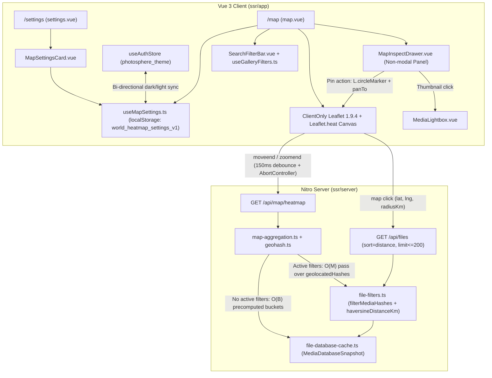

# World Map Heatmap & Spatial Inspector

*   **Author:** alessandro-candon
*   **Status:** Draft
*   **Date:** 2026-11-24

--------------------------------------------------------------------------------

## Overview

This design introduces an interactive world map view (`/map`) and a dedicated map preferences section inside the existing settings view (`/settings`) of the Photosphere Nuxt 4 web application (`ssr/`). The feature lets users visually explore archives of 100,000+ geolocated photos and videos across the globe using a progressive-zoom HTML5 Canvas heatmap, inspect items within a clicked geographic area, pin specific media locations on the map, and open full-resolution media in the existing lightbox viewer while persisting visual preferences locally in the browser.

## The Problem

Photosphere users manage personal media libraries containing over 100,000 photos and videos stored with GPS coordinates (`latitude`, `longitude`) and geohash identifiers (`geohash`). Currently, spatial discovery in the web application is limited to typing a place name into the text-based location autocomplete input in `SearchFilterBar.vue`, which queries OpenStreetMap Nominatim and filters the timeline grid around a single coordinate and radius.

This text-only workflow has three limitations for users exploring large libraries:

1.  **No Global or Regional Spatial Visibility:** Users cannot see where their media collection is concentrated across countries, cities, or neighborhoods without already knowing which place name to search for.
2.  **Scale vs. Browser Performance Bottleneck:** Rendering 100,000+ individual markers or sending multi-megabyte coordinate arrays over the network on every pan and zoom stalls browser frame rates and increases server payload latency.
3.  **Fragmented Inspection & Configuration:** Users need a way to move from a macro density overview down to inspecting and previewing specific photos at a street or neighborhood level, while keeping map visual tuning controls (basemap style, clustering mode, heatmap radius, blur, and intensity) out of the way of the map viewport in a persistent settings form.

The proposed solution addresses these problems by combining zoom-adaptive server-side geohash aggregation in memory with a client-only Leaflet and `Leaflet.heat` Canvas layer, a non-modal click-to-inspect drawer connected to the existing media lightbox, and a `localStorage`-backed settings card integrated with the application theme.

## Goals

*   **Progressive Global-to-Local Spatial Exploration:** Render a full-viewport interactive world map (`minZoom: 2`, `maxZoom: 16`, `worldCopyJump: true`) with zero-API-key Esri ArcGIS basemaps (`Dark`, `Light`, `Satellite`) and an HTML5 Canvas heatmap that recalculates geohash precision (`2` to `6` characters) and optional dynamic pixel radius as the user zooms and pans.
*   **Sub-20ms In-Memory Spatial Aggregation for 100,000+ Items:** Serve viewport-bounded heatmap clusters from the existing in-memory `MediaDatabaseSnapshot` (`< 2 ms` on the unfiltered precomputed bucket path and `< 20 ms` when filtered by active gallery criteria) without adding external database dependencies.
*   **Filter-Consistent Map View:** Support all existing gallery filter criteria (`q`, `searchField`, `labelIndex`, `captionIndex`, `fileType`, `dateFrom`, `dateTo`, `memoryDate`, `album`, `notInAlbum`) on the map view so the heatmap and area inspector reflect the active query.
*   **Safe Raw-Point Inspection Mode:** Allow users to switch between aggregated geohash mode and raw coordinate mode, with an automatic server-side fallback to geohash aggregation whenever matching points in the active viewport exceed `5,000`.
*   **Click-to-Inspect Area & Pin Workflow:** Allow clicking any point on the map to draw a zoom-proportional dashed inspection circle (`0.1` to `100` km radius) and open a non-modal inspector drawer displaying total matches and distance-sorted paginated items (`10` to `200` per page, default `30`), where each item can either be pinned on the map (`L.circleMarker` + `map.panTo`) or opened in `MediaLightbox.vue`.
*   **Client-Side Preference Persistence & Theme Cohesion:** Provide a map settings section in `/settings` persisted to `localStorage` under `world_heatmap_settings_v1`, with schema validation, default fallback merging, bi-directional theme synchronization for `dark` and `light` basemaps, and non-blocking toast confirmation on save or reset.

## Non-Goals

*   **External Spatial Databases:** Introducing SQLite, DuckDB, PostGIS, or any external database server outside the existing GCS-backed in-memory JSON snapshot cache.
*   **Server-Side Map Settings Storage:** Persisting map visual tuning parameters (`baseRadius`, `blur`, `maxIntensity`, `dataMode`, `basemap`) in cloud storage or user profile records.
*   **Paid or Keyed Map Tile Services:** Integrating Google Maps, Mapbox, or tile providers that require API keys, billing accounts, or Referer policy whitelisting.
*   **Geotag Editing:** Adding, modifying, or deleting GPS coordinates on media records from the map interface.

## Open Questions

*   None at this stage. All core architectural questions regarding in-memory indexing, click-to-inspect Haversine sorting, raw-mode fallback, and theme synchronization were resolved during the ideation phase.

## Critical User Journeys (CUJs)

### CUJ 1: Global-to-Street Heatmap Exploration with Active Filters

*   **Given**: An authenticated user with 100,000+ media items (including geolocated photos and videos) navigates to `/map` via the `AppShell` navigation bar, with default map settings (`dataMode: 'geohash'`, `dynamicRadius: true`).
*   **When**: The user views the world map at `zoom: 3`, applies an album or date range filter in `SearchFilterBar`, and progressively zooms into a city up to `zoom: 14`.
*   **Then**: The map initially renders aggregated 2-character geohash heat clusters matching the active filter; on each `zoomend` or `moveend`, the client requests viewport-bounded clusters at increasing geohash precision (`2` up to `6`), scales the heatmap point radius proportionally to the zoom level, and redraws the Canvas without blocking UI interactions.

### CUJ 2: Click-to-Inspect Area, Pin on Map, and Full-Screen Lightbox Preview

*   **Given**: The user is viewing the heatmap on `/map` at any zoom level between `2` and `16`.
*   **When**: The user clicks a heatmap hotspot on the map, then clicks the "Pin on map" button on the second item in the inspector drawer, and subsequently clicks the third item's thumbnail.
*   **Then**:
    1. A dashed highlight circle (`L.circle`) appears around the clicked coordinate with a radius proportional to the current zoom (`0.1` to `100` km), and the non-modal `MapInspectDrawer` opens showing the total matching count, inspected coordinates/radius, and the first page of items sorted by ascending distance from the click center.
    2. Clicking "Pin on map" places a highlighted `L.circleMarker` with a tooltip at that item's exact GPS coordinates and smoothly pans the visible map canvas (`map.panTo`) without a modal scrim obscuring the map.
    3. Clicking a thumbnail opens `MediaLightbox.vue` for full-resolution photo or video playback, keyboard navigation across the inspected items, and album assignment.

### CUJ 3: Configuring Map Preferences and Synchronizing Basemap Theme

*   **Given**: The user navigates to `/settings` where the existing Appearance section and the new Map Settings card (`MapSettingsCard.vue`) are displayed.
*   **When**: The user changes the basemap to `Satellite`, switches data mode to `Raw`, adjusts `baseRadius` to `24`, `blur` to `20`, `maxIntensity` to `2.5`, and `maxInspectResults` to `50`, and clicks "Save Settings" (or later clicks "Reset Defaults").
*   **Then**: The validated configuration object is written to `localStorage` under `world_heatmap_settings_v1`, a non-blocking toast notification confirms the action, and returning to `/map` applies the `World_Imagery` satellite basemap and updated heatmap options (automatically falling back to geohash clustering with an indicator badge if the current viewport contains more than `5,000` raw points).

## Technical Plan (Architecture)

### 1. High-Level System Architecture & Data Flow

The feature extends the existing Nuxt 4 application (`ssr/`) across two layers:
1. **Nitro Server Layer (`ssr/server/`):** Augments the in-memory `MediaDatabaseSnapshot` in `ssr/server/utils/file-database-cache.ts` with precomputed spatial indexes and exposes viewport-bounded heatmap clustering (`GET /api/map/heatmap`) alongside distance-sorted spatial inspection (`GET /api/files` with `sort=distance`).
2. **Vue 3 Client Layer (`ssr/app/`):** Adds a client-only Leaflet + `Leaflet.heat` map page (`ssr/app/pages/map.vue`), a non-modal area inspector drawer (`ssr/app/components/organisms/MapInspectDrawer.vue`), a shared `localStorage` settings composable (`ssr/app/composables/useMapSettings.ts`), and a settings form card (`ssr/app/components/organisms/MapSettingsCard.vue`) embedded inside `ssr/app/pages/settings.vue`.



### 2. In-Memory Spatial Indexing & Two-Tier Aggregation

#### Snapshot Index Extensions (`ssr/server/utils/file-database-cache.ts` & `ssr/server/utils/geohash.ts`)
When `getMediaDatabase()` loads `photosphere_database_cloud.json` and calls `buildDerivedMediaIndexes(recordsByHash, sortedHashes)`, it builds two additional spatial structures inside `MediaDatabaseSnapshot`:

*   **`geolocatedHashes: string[]`**: Ordered subset of `sortedHashes` where `typeof rec.latitude === 'number' && Number.isFinite(rec.latitude) && rec.latitude >= -90 && rec.latitude <= 90` and `typeof rec.longitude === 'number' && Number.isFinite(rec.longitude) && rec.longitude >= -180 && rec.longitude <= 180`.
*   **Canonical Geohash Backfill**: If a geolocated record has a `null` or shorter-than-6-character `geohash` field, `encodeGeohash(rec.latitude, rec.longitude, 6)` in `ssr/server/utils/geohash.ts` computes and stores a canonical 6-character base32 geohash string on the in-memory record.
*   **`unfilteredGeohashBuckets: Record<2 | 3 | 4 | 5 | 6, GeohashClusterBucket[]>`**: Pre-aggregated buckets for all five zoom precision levels across the entire dataset:
    ```ts
    export interface GeohashClusterBucket {
      prefix: string
      count: number
      avgLat: number
      avgLng: number
    }
    ```
    Because `MediaDatabaseSnapshot` is replaced atomically on `invalidateFileDatabaseCache()` / `POST /api/admin/refresh-database`, these spatial indexes never drift out of sync with the underlying media records.

#### Zoom-to-Geohash Precision & Logarithmic Weight Normalization
1.  **Precision Mapping (`resolveGeohashPrecision(zoom: number)`):**
    *   `zoom <= 3` $\rightarrow$ precision `2`
    *   `zoom <= 5` $\rightarrow$ precision `3`
    *   `zoom <= 8` $\rightarrow$ precision `4`
    *   `zoom <= 11` $\rightarrow$ precision `5`
    *   `zoom >= 12` $\rightarrow$ precision `6`
2.  **Two-Tier Execution Path (`ssr/server/utils/map-aggregation.ts`):**
    *   **Tier 1 — Unfiltered Fast Path (`O(B)`):** When no `GalleryFilters` (`q`, `labelIndex`, `captionIndex`, `fileType`, `dateFrom`, `dateTo`, `memoryDate`, `album`, `notInAlbum`) are active and `mode === 'geohash'`, the server scans `snapshot.unfilteredGeohashBuckets[precision]` (typically `<= 5,000` buckets for 100,000+ records) and filters buckets whose `(avgLat, avgLng)` falls inside the normalized viewport bounding box.
    *   **Tier 2 — Filtered Pass (`O(M)`):** When any gallery filter is active (or when `mode === 'raw'`), `filterMediaHashes` runs with `baseHashes` restricted to `snapshot.geolocatedHashes` (unless `memoryDate` narrows `baseHashes` even further via `snapshot.byMonthDay[memoryDate]`). Matched records inside the normalized viewport bounding box are either returned as raw points (if `mode === 'raw'` and count `<= 5,000`) or grouped into a `Map<string, { count: number; sumLat: number; sumLng: number }>` keyed by `rec.geohash.slice(0, precision)`.
3.  **Raw Mode Safety Threshold (`RAW_MODE_MAX_POINTS = 5000`):**
    *   When the client requests `mode=raw`, the server counts matching geolocated records in the active viewport. If the count exceeds `5,000`, the server automatically aggregates them by `resolveGeohashPrecision(zoom)` and sets `effectiveMode: 'geohash'` and `fallbackTriggered: true` in the response.
4.  **Logarithmic Weight Formula:**
    *   In `geohash` mode, given bucket count $c_i$ and maximum bucket count in the current viewport $C_{\max} = \max_i c_i$:
        $$w_i = \begin{cases} 1.0 & \text{if } C_{\max} \le 1 \\ \operatorname{clamp}\left(\frac{\ln(c_i + 1)}{\ln(C_{\max} + 1)}, 0.08, 1.0\right) & \text{if } C_{\max} > 1 \end{cases}$$
    *   In `raw` mode (when not falling back), each individual media point is emitted as `[rec.latitude, rec.longitude, 0.75]`.

#### Antimeridian & `worldCopyJump` Viewport Bounds Normalization
When `worldCopyJump: true` is active in Leaflet, `map.getBounds()` can return longitudes outside `[-180, 180]` or a span `east - west >= 360`. Server utility `normalizeViewportBounds(rawNorth, rawSouth, rawEast, rawWest)` normalizes bounds as follows:
1.  Clamp `south = clamp(Math.min(rawSouth, rawNorth), -90, 90)` and `north = clamp(Math.max(rawSouth, rawNorth), -90, 90)`.
2.  If `!Number.isFinite(rawEast) || !Number.isFinite(rawWest) || rawEast - rawWest >= 360`, mark `fullWorldLng = true` (all longitudes `[-180, 180]` match).
3.  Otherwise wrap `west = ((((rawWest + 180) % 360) + 360) % 360) - 180` and `east = ((((rawEast + 180) % 360) + 360) % 360) - 180`.
4.  A point `(lat, lng)` is inside the viewport if `lat >= south && lat <= north` and:
    *   `fullWorldLng === true`, or
    *   `west <= east` and `lng >= west && lng <= east`, or
    *   `west > east` (antimeridian crossing) and `(lng >= west || lng <= east)`.

### 3. API Contracts

#### `GET /api/map/heatmap` (`ssr/server/api/map/heatmap.get.ts`)
*   **Authentication:** Requires Firebase Bearer ID token via `requireBearerToken(event)`.
*   **Query Parameters:**
    *   Viewport & Map: `north` (number), `south` (number), `east` (number), `west` (number), `zoom` (integer `2..16`, default `3`), `mode` (`'geohash' | 'raw'`, default `'geohash'`), `lang` (string, optional).
    *   Gallery Filters: `q`, `searchField` (`'labels' | 'captions'`), `labelIndex`, `captionIndex`, `fileType` (`'FILE' | 'IMAGE' | 'VIDEO'`), `dateFrom`, `dateTo`, `memoryDate`, `album`, `notInAlbum`.
*   **Response Schema (`HeatmapApiResponse`):**
    ```ts
    export type HeatmapPointTuple = [number, number, number] // [lat, lng, weight]

    export interface HeatmapApiResponse {
      points: HeatmapPointTuple[]
      precision: 2 | 3 | 4 | 5 | 6
      requestedMode: 'geohash' | 'raw'
      effectiveMode: 'geohash' | 'raw'
      fallbackTriggered: boolean
      viewportPointCount: number
      totalGeolocatedCount: number
      maxBucketCount: number
    }
    ```

#### Extended `GET /api/files` (`ssr/server/api/files/index.get.ts` & `ssr/server/utils/file-filters.ts`)
To avoid duplicating filtering and pagination endpoints while supporting Click-to-Inspect:
1.  **Limit Cap:** Raise maximum `limit` in `GET /api/files` from `100` to `200` to match `maxInspectResults` (`10..200`).
2.  **Radius Clamp:** Keep `radiusKm` clamped in `[0.1, 100]` km for map inspection queries (while retaining support up to `1000` km if explicitly queried).
3.  **Distance Sorting (`sort=distance`):** Add optional `sort` query parameter (`'date' | 'distance'`, default `'date'`). When `sort === 'distance'` and valid `lat` and `lng` parameters are supplied, compute `distanceKm = haversineDistanceKm(lat, lng, rec.latitude, rec.longitude)` for each matching record and sort matches by ascending `distanceKm` (tie-breaking by descending `created_at_timestamp`, then `hash`).
4.  **DTO Extension (`MediaGridItemDto` & client `MediaGridItem`):**
    ```ts
    export interface MediaGridItemDto {
      hash: string
      fileType: MediaFileType
      createdAt: string | null
      createdAtTimestamp: number | null
      fileName: string
      hasThumbnail: boolean
      thumbnailUrl: string | null
      sourceUrl: string
      latitude: number | null
      longitude: number | null
      geohash: string | null
      distanceKm?: number | null
    }
    ```

### 4. Frontend Map Engine, Click-to-Inspect & Component Hierarchy

#### SSR-Safe Leaflet & `Leaflet.heat` Initialization (`ssr/app/pages/map.vue`)
*   The map viewport is rendered inside `<ClientOnly>` with a skeleton fallback.
*   Inside `onMounted`, the client dynamically imports `leaflet`, assigns `(window as unknown as { L: typeof L }).L = L`, and then imports `leaflet.heat` so the UMD plugin registers `L.heatLayer` cleanly under Vite ESM bundling.
*   **Stacking Context Isolation:** The map container div uses Tailwind classes `isolate relative z-0 overflow-hidden rounded-xl border border-border` so Leaflet's internal pane z-indexes (`400..1000`) are contained within `z-0` and never overlap `SearchFilterBar` autocomplete dropdowns (`z-20`), `AppShell` navigation (`z-30`), or `MediaLightbox` / `AlbumPickerSheet` (`z-50`).
*   **Esri Zero-API-Key Tile Layers:**
    *   `dark`: `L.layerGroup` combining `Canvas/World_Dark_Gray_Base/MapServer/tile/{z}/{y}/{x}` and `Canvas/World_Dark_Gray_Reference/MapServer/tile/{z}/{y}/{x}`.
    *   `light`: `L.layerGroup` combining `Canvas/World_Light_Gray_Base/MapServer/tile/{z}/{y}/{x}` and `Canvas/World_Light_Gray_Reference/MapServer/tile/{z}/{y}/{x}`.
    *   `satellite`: `World_Imagery/MapServer/tile/{z}/{y}/{x}`.
*   **Dynamic Zoom Radius Calculation:**
    *   When `settings.dynamicRadius === true`, on every `zoomend` event:
        $$\text{radius} = \operatorname{clamp}\left(\operatorname{round}\left(\text{baseRadius} \times (0.65 + (\text{zoom} - 2) \times 0.08)\right), 5, 60\right)$$
        $$\text{blur} = \operatorname{clamp}\left(\operatorname{round}\left(\text{settings.blur} \times (0.75 + (\text{zoom} - 2) \times 0.05)\right), 5, 50\right)$$
    *   When `settings.dynamicRadius === false`, `radius = settings.baseRadius` and `blur = settings.blur`.
    *   Applied via `heatLayer.setOptions({ radius, blur, max: settings.maxIntensity })`.

#### Click-to-Inspect Area & Non-Modal `MapInspectDrawer.vue`
1.  **Zoom-Proportional Geographic Radius:**
    *   On `map.on('click', (e) => ...)`, compute the inspection radius in kilometers:
        $$\text{radiusKm} = \operatorname{clamp}\left(\operatorname{roundTo2Decimals}\left(100 \times 2^{-\max(0, \text{zoom} - 4) \times 0.75}\right), 0.1, 100\right)$$
    *   Draw or update a dashed highlight `L.circle([e.latlng.lat, e.latlng.lng], { radius: radiusKm * 1000, dashArray: '6, 6' })` on the map.
2.  **Query & Pagination:**
    *   Call `GET /api/files` via `usePhotosphereApi().fetchFiles` with active `GalleryFilters` overridden by `{ lat: clickLat, lng: clickLng, radiusKm, sort: 'distance', page: 1, limit: settings.maxInspectResults }`.
    *   Support "Load more" pagination (`page + 1`) inside the drawer when `hasMore === true`.
3.  **Non-Modal Drawer Interaction (`ssr/app/components/organisms/MapInspectDrawer.vue`):**
    *   Rendered as a non-blocking dockable overlay panel on the right side of the map container on desktop (`md:w-96`) and a bottom panel on mobile, without a full-screen backdrop scrim.
    *   **Pin on Map Action:** Clicking the pin button on an item places or moves a dedicated `L.circleMarker([item.latitude, item.longitude])` with a bound tooltip (`fileName`, `createdAt`, `distanceKm`) and calls `map.panTo([item.latitude, item.longitude])`.
    *   **Open Lightbox Action:** Clicking an item's thumbnail opens `MediaLightbox.vue` bound to the inspected item list so the user can view the full image/video, navigate with arrow keys, or add the item to an album via `AlbumPickerSheet.vue`.
    *   **Close Action (`✕`):** Closes the drawer and removes both the dashed `L.circle` and any active `L.circleMarker` pin from the map.

### 5. Settings Persistence & Theme Synchronization (`useMapSettings.ts` & `MapSettingsCard.vue`)

*   **`localStorage` Key:** `'world_heatmap_settings_v1'`
*   **Schema & Validation (`ssr/app/composables/useMapSettings.ts`):**
    ```ts
    export interface WorldHeatmapSettings {
      basemap: 'dark' | 'light' | 'satellite'
      dataMode: 'geohash' | 'raw'
      dynamicRadius: boolean
      baseRadius: number // 5..45, default 16
      blur: number // 5..35, default 15
      maxIntensity: number // 0.5..10.0, default 1.8
      maxInspectResults: number // 10..200, default 30
    }
    ```
    On initialization, `loadMapSettings(fallbackTheme)` parses `localStorage.getItem('world_heatmap_settings_v1')`, clamps numeric fields to their valid intervals, falls back to `fallbackTheme` (`authStore.theme`) for `basemap` if no valid stored setting exists, and merges defaults on missing or corrupted JSON.
*   **Theme Synchronization with `useAuthStore`:**
    *   When `authStore.setTheme(mode)` or `authStore.toggleTheme()` changes `theme` between `'dark'` and `'light'`, if the current map `basemap` is `'dark'` or `'light'`, `useMapSettings` updates `basemap` to match `mode` and persists it. If `basemap === 'satellite'`, it remains `'satellite'`.
    *   Conversely, if the user saves `basemap: 'dark'` or `basemap: 'light'` in `MapSettingsCard.vue`, `authStore.setTheme(settings.basemap)` is invoked so app appearance stays aligned.
*   **Cross-View & Cross-Tab Notification:**
    *   Saving or resetting dispatches `window.dispatchEvent(new CustomEvent('heatmap-settings-updated', { detail: settings }))` and updates module-scoped reactive state so `/map` reflects changes immediately within the SPA and across browser tabs via the `storage` event.

## Alternatives Considered

### Alternative A: Standalone Vanilla JavaScript Modules (`map-heatmap.js` & `map-settings.js`)

*   **Pros**: Matches the file naming of the original standalone proof-of-concept prompt and has zero framework coupling.
*   **Cons**: Cannot reuse Nuxt 4 routing, Firebase bearer token session handling (`usePhotosphereApi`), reactive gallery filters (`SearchFilterBar.vue` and `useGalleryFilters.ts`), the global theme store (`useAuthStore`), or existing components (`SettingsSectionCard.vue` and `MediaLightbox.vue`).
*   **Reason for Rejection**: Rejected by author: the original prompt was generated from an isolated proof-of-concept template to validate the functional goal, whereas the production target is the existing Nuxt 4 + Vue 3 + TypeScript application in `ssr/`.

### Alternative B: Embedded In-Memory SQLite Database (`better-sqlite3` / `sql.js`)

*   **Pros**: Allows executing literal SQL queries such as `SELECT AVG(lat), AVG(lng), COUNT(*) FROM media GROUP BY SUBSTR(geohash, 1, :precision)` and `WHERE geohash LIKE :prefix`.
*   **Cons**: Duplicates the in-memory footprint of 100,000+ media records that are already parsed and held in `mediaDbCache` (`ssr/server/utils/file-database-cache.ts`), adds native C++ or WASM build dependencies to the Docker container, and requires synchronizing a second storage engine whenever an admin triggers `POST /api/admin/refresh-database`.
*   **Reason for Rejection**: Rejected by author: extending `MediaDatabaseSnapshot` and `ssr/server/utils/file-filters.ts` in memory follows the DRY principle, adds zero external database dependencies, and achieves `< 2 ms` unfiltered and `< 20 ms` filtered aggregation latency.

### Alternative C: Unbounded `raw` Coordinate Mode at All Zoom Levels

*   **Pros**: Directly honors `dataMode: 'raw'` without mode switching or fallback badges.
*   **Cons**: At world or continental zoom levels (`zoom 2..7`), returning 100,000+ `[lat, lng, weight]` tuples produces a ~3 MB JSON payload per pan/zoom event and forces `Leaflet.heat` (`simpleheat`) to redraw 100,000 points on the HTML5 Canvas main thread, causing browser frame drops.
*   **Reason for Rejection**: Rejected by author: enforcing a viewport point threshold (`RAW_MODE_MAX_POINTS = 5000`) with automatic server-side fallback to geohash aggregation prevents browser stalls at low zoom while preserving exact raw points when zoomed in or when gallery filters narrow the result set.

### Alternative D: Single Geohash Prefix Filtering for Click-to-Inspect (`geohash.startsWith(clickedPrefix)`)

*   **Pros**: Simple string prefix comparison without trigonometric distance math.
*   **Cons**: Geohash cells have hard rectangular boundaries (including major seams along the equator, prime meridian, and adjacent base32 cells). A click near a cell edge drops media items located only a few meters away in the neighboring geohash cell, and prefix matching alone does not order items by proximity to the clicked center.
*   **Reason for Rejection**: Rejected by author: reusing the existing latitude/longitude bounding-box pre-filter and `haversineDistanceKm` calculation in `ssr/server/utils/file-filters.ts` (clamped to `[0.1, 100]` km) with `sort=distance` guarantees circular coverage around the clicked coordinate and orders results from closest to farthest.

--------------------------------------------------------------------------------

## Non-Functional Requirements

*   **Security & Privacy**:
    *   `GET /api/map/heatmap` and `GET /api/files` enforce Firebase authentication via `requireBearerToken(event)` and existing allowlist middleware; unauthenticated requests receive `401 Unauthorized`.
    *   Esri ArcGIS public basemap tiles are loaded directly over HTTPS (`https://server.arcgisonline.com/ArcGIS/rest/services/...`) without API keys or user-identifying query parameters.
    *   Client map preferences in `localStorage` (`world_heatmap_settings_v1`) contain only visual tuning parameters and zero personally identifiable information or auth tokens.
*   **Performance & Latency**:
    *   **Server Memory Overhead**: Precomputing `geolocatedHashes` (`<= 100,000` 40-char SHA-1 references) and `unfilteredGeohashBuckets` across precisions `2..6` adds `< 12 MB` to the Node.js heap alongside the existing `MediaDatabaseSnapshot`.
    *   **Server Query Latency**: `< 2 ms` p95 for unfiltered `geohash` heatmap requests (`O(B)` bucket scan) and `< 20 ms` p95 for filtered heatmap or click-to-inspect requests across 100,000 geolocated records.
    *   **Client Network & Render Hygiene**: Map `moveend` and `zoomend` handlers use a `150 ms` debounce and cancel in-flight requests via `AbortController` so rapid panning never queues redundant heatmap payloads.
*   **Rollout & Rollback**:
    *   The feature is additive: `MediaGridItemDto` gains optional/nullable coordinate fields (`latitude`, `longitude`, `geohash`, `distanceKm`) that preserve backward compatibility with all existing gallery, album, and memory views.
    *   Rolling back requires only removing the `/map` route link from `AppShell.vue` and `MapSettingsCard.vue` from `settings.vue`; no cloud JSON database schema migration is required.

--------------------------------------------------------------------------------

## Detailed Implementation Plan

### Target Files to Create/Modify

#### 1. [`./ssr/package.json`](../../ssr/package.json) (Modify)

*   **Type / Scope**: Package Manifest & Dependencies
*   **Proposed Changes**: Add runtime dependencies `leaflet` (`^1.9.4`) and `leaflet.heat` (`^0.2.0`) under `dependencies`, and `@types/leaflet` (`^1.9.16`) under `devDependencies`. Necessary to provide the client-side Canvas map engine, heatmap binning plugin, and TypeScript definitions.

#### 2. [`./ssr/server/types/cache/index.ts`](../../ssr/server/types/cache/index.ts) (Modify)

*   **Type / Scope**: Server TypeScript Interfaces
*   **Proposed Changes**: Define `GeohashPrecision = 2 | 3 | 4 | 5 | 6` and `GeohashClusterBucket` (`prefix: string`, `count: number`, `avgLat: number`, `avgLng: number`), and extend `MediaDatabaseSnapshot` with `geolocatedHashes: string[]` and `unfilteredGeohashBuckets: Record<GeohashPrecision, GeohashClusterBucket[]>`. Necessary so the in-memory snapshot carries pre-indexed spatial structures across cache reads and invalidations.

#### 3. `./ssr/server/utils/geohash.ts` (Create)

*   **Type / Scope**: Server Spatial Utility Module
*   **Proposed Changes**: Implement pure TypeScript geohash and coordinate helpers: `isValidCoordinatePair(lat: unknown, lng: unknown): boolean`, `encodeGeohash(lat: number, lng: number, precision?: number): string` (standard base32 interval-bisection encoder), and `resolveGeohashPrecision(zoom: number): GeohashPrecision` mapping zoom ranges (`<=3 -> 2`, `<=5 -> 3`, `<=8 -> 4`, `<=11 -> 5`, `>=12 -> 6`). Necessary to guarantee canonical 6-character geohashes on all geolocated records and consistent zoom-level bucketing.

#### 4. [`./ssr/server/utils/file-database-cache.ts`](../../ssr/server/utils/file-database-cache.ts) (Modify)

*   **Type / Scope**: In-Memory Snapshot Loader & Index Builder
*   **Proposed Changes**: Update `buildDerivedMediaIndexes(recordsByHash, sortedHashes)` and `getMediaDatabase()` to partition `geolocatedHashes`, backfill a 6-character `geohash` via `encodeGeohash` when a record has valid `latitude` and `longitude` but a missing or short `geohash`, and pre-aggregate `unfilteredGeohashBuckets` for precisions `2` through `6`. Necessary to enable `< 2 ms` unfiltered heatmap queries and atomic re-indexing on `invalidateFileDatabaseCache()`.

#### 5. [`./ssr/server/utils/file-filters.ts`](../../ssr/server/utils/file-filters.ts) (Modify)

*   **Type / Scope**: Server Filtering & DTO Mapper
*   **Proposed Changes**:
    *   Extend `MediaGridItemDto` with `latitude: number | null`, `longitude: number | null`, `geohash: string | null`, and `distanceKm?: number | null`, and update `toMediaGridItem(rec, distanceKm?)` to populate these fields.
    *   Extend `filterMediaHashes` options to accept an optional `baseHashes?: string[]` override (allowing the map aggregation pass to iterate only `snapshot.geolocatedHashes`).
    *   Add a helper `sortMediaHashesByDistance(snapshot, hashes, centerLat, centerLng): Array<{ hash: string; distanceKm: number }>` using `haversineDistanceKm` with ascending distance order and descending `created_at_timestamp` tie-breaking. Necessary so click-to-inspect returns distance-sorted items with GPS coordinates for map pinning.

#### 6. `./ssr/server/utils/map-aggregation.ts` (Create)

*   **Type / Scope**: Server Heatmap Aggregation Engine
*   **Proposed Changes**: Implement `RAW_MODE_MAX_POINTS = 5000`, `normalizeViewportBounds(north, south, east, west)` (clamping latitude to `[-90, 90]`, detecting full-world spans `east - west >= 360`, and wrapping antimeridian crossings `west > east`), `isPointInViewport(lat, lng, bounds)`, `hasActiveNonSpatialFilters(filters)`, and `aggregateViewportHeatmap(snapshot, params, options)`. Implements the two-tier aggregation strategy (`O(B)` precomputed bucket scan when unfiltered; `O(M)` pass over `geolocatedHashes` when filtered), logarithmic weight normalization `clamp(ln(c_i + 1) / ln(C_max + 1), 0.08, 1.0)`, and automatic `raw`-to-`geohash` fallback above `5,000` viewport points.

#### 7. `./ssr/server/api/map/heatmap.get.ts` (Create)

*   **Type / Scope**: Nitro H3 API Endpoint (`GET /api/map/heatmap`)
*   **Proposed Changes**: Validate bearer token via `requireBearerToken(event)`, parse viewport query parameters (`north`, `south`, `east`, `west`, `zoom`, `mode`, `lang`) and `GalleryFilters` (`q`, `searchField`, `labelIndex`, `captionIndex`, `fileType`, `dateFrom`, `dateTo`, `memoryDate`, `album`, `notInAlbum`), load cached `snapshot` (plus language dictionaries when `q` is present and albums when `album` or `notInAlbum` is present), invoke `aggregateViewportHeatmap`, and return `HeatmapApiResponse`.

#### 8. [`./ssr/server/api/files/index.get.ts`](../../ssr/server/api/files/index.get.ts) (Modify)

*   **Type / Scope**: Nitro H3 API Endpoint (`GET /api/files`)
*   **Proposed Changes**: Raise the upper clamp on `limit` from `100` to `200` to support `maxInspectResults` (`10..200`), parse optional query parameter `sort` (`'date' | 'distance'`, defaulting to `'date'`), and when `sort === 'distance'` with finite `lat` and `lng`, sort matched hashes via `sortMediaHashesByDistance` before pagination and attach `distanceKm` to each `MediaGridItemDto`.

#### 9. [`./ssr/app/constants/api/index.ts`](../../ssr/app/constants/api/index.ts) (Modify)

*   **Type / Scope**: Client API Route Constants
*   **Proposed Changes**: Add `mapHeatmap: '/api/map/heatmap'` to `API_ENDPOINTS`. Necessary for type-safe endpoint resolution in `usePhotosphereApi`.

#### 10. [`./ssr/app/types/media.ts`](../../ssr/app/types/media.ts) (Modify)

*   **Type / Scope**: Client Domain & API Types
*   **Proposed Changes**: Extend `MediaGridItem` with `latitude: number | null`, `longitude: number | null`, `geohash: string | null`, and `distanceKm?: number | null`. Add types `BasemapStyle = 'dark' | 'light' | 'satellite'`, `HeatmapDataMode = 'geohash' | 'raw'`, `WorldHeatmapSettings`, `HeatmapPointTuple = [number, number, number]`, `HeatmapQueryParams`, and `HeatmapApiResponse`.

#### 11. `./ssr/app/types/leaflet-heat.d.ts` (Create)

*   **Type / Scope**: Ambient TypeScript Declaration
*   **Proposed Changes**: Declare module `'leaflet.heat'` and augment namespace `L` with `HeatLatLngTuple`, `HeatMapOptions` (`minOpacity`, `maxZoom`, `max`, `radius`, `blur`, `gradient`), `HeatLayer` (`setOptions`, `setLatLngs`, `addLatLng`, `redraw`), and `heatLayer(latlngs, options?)`. Necessary so `nuxt typecheck` and `vue-tsc --noEmit` compile without untyped external plugin errors.

#### 12. `./ssr/app/composables/useMapSettings.ts` (Create)

*   **Type / Scope**: Vue 3 Composable (`localStorage` State & Theme Sync)
*   **Proposed Changes**: Define `WORLD_HEATMAP_SETTINGS_KEY = 'world_heatmap_settings_v1'` and `DEFAULT_WORLD_HEATMAP_SETTINGS` (`basemap: 'dark'`, `dataMode: 'geohash'`, `dynamicRadius: true`, `baseRadius: 16`, `blur: 15`, `maxIntensity: 1.8`, `maxInspectResults: 30`). Export pure helper `validateAndMergeMapSettings(raw, fallbackTheme)` (clamping `baseRadius` to `[5, 45]`, `blur` to `[5, 35]`, `maxIntensity` to `[0.5, 10.0]`, `maxInspectResults` to `[10, 200]`), `computeDynamicHeatOptions(zoom, settings)`, `computeInspectRadiusKm(zoom)`, and reactive actions `saveMapSettings(next)`, `resetMapSettings()`, and bi-directional theme synchronization with `useAuthStore().theme` plus `CustomEvent('heatmap-settings-updated')` and `window.addEventListener('storage')`.

#### 13. [`./ssr/app/composables/useGalleryFilters.ts`](../../ssr/app/composables/useGalleryFilters.ts) (Modify)

*   **Type / Scope**: Vue 3 Route Filter Composable
*   **Proposed Changes**: Update `filters` computed parsing and `applyFilters` query serialization to read and write `album` and `memoryDate` alongside existing filter parameters. Necessary so all gallery filters supported by the server can be applied and preserved in URL query state on `/map`.

#### 14. [`./ssr/app/composables/usePhotosphereApi.ts`](../../ssr/app/composables/usePhotosphereApi.ts) (Modify)

*   **Type / Scope**: Client API Composable
*   **Proposed Changes**:
    *   Update `listFiles(filters, page, limit, options?: { sort?: 'date' | 'distance'; signal?: AbortSignal })` to append `sort` to query params and forward `signal` to `requestJson`.
    *   Add `fetchHeatmapClusters(params: HeatmapQueryParams, filters?: GalleryFilters, signal?: AbortSignal): Promise<HeatmapApiResponse>` calling `API_ENDPOINTS.mapHeatmap`.

#### 15. `./ssr/app/components/organisms/MapSettingsCard.vue` (Create)

*   **Type / Scope**: Vue 3 Settings Organism Component
*   **Proposed Changes**: Wrap a dedicated map configuration form inside `SettingsSectionCard.vue` with controls for:
    1. Basemap Style (`dark` | `light` | `satellite`),
    2. Data Mode (`geohash` | `raw`),
    3. Dynamic Zoom Radius (`checkbox` / switch),
    4. Base Radius (`5..45` px range + numeric readout),
    5. Blur (`5..35` px range + numeric readout),
    6. Max Intensity (`0.5..10.0` step `0.1` range + numeric readout),
    7. Max Inspector Results per Click (`10..200` number input),
    8. "Save Settings" and "Reset Defaults" buttons with a non-blocking auto-dismissing toast notification banner (`role="status"`, `aria-live="polite"`).

#### 16. [`./ssr/app/pages/settings.vue`](../../ssr/app/pages/settings.vue) (Modify)

*   **Type / Scope**: Nuxt 4 Settings Page
*   **Proposed Changes**: Import and render `MapSettingsCard.vue` inside the `/settings` page container below the AI Labels & Captions Language card, and connect `useMapSettings` so toggling the global Appearance theme updates non-satellite basemaps consistently.

#### 17. `./ssr/app/components/organisms/MapInspectDrawer.vue` (Create)

*   **Type / Scope**: Vue 3 Non-Modal Map Inspector Organism Component
*   **Proposed Changes**: Render a dockable side/bottom drawer (without a blocking full-screen backdrop scrim) displaying:
    *   Header with total matched items count, inspected center coordinates (`lat, lng`), calculated radius (`km`), and quick close button (`✕`).
    *   Scrollable list of matched `MediaGridItem` cards showing thumbnail preview, filename, capture date, geohash badge, and distance from clicked center (`distanceKm`).
    *   Two distinct actions per item: clicking the thumbnail emits `open-lightbox(index)` to open `MediaLightbox.vue`; clicking the "Pin on map" button emits `pin-item(item)` to place an `L.circleMarker` and pan the map.
    *   "Load more" pagination button when `hasMore` is true.

#### 18. `./ssr/app/pages/map.vue` (Create)

*   **Type / Scope**: Nuxt 4 Interactive Map Page (`/map`)
*   **Proposed Changes**:
    *   Render `PageHeader.vue` (with active mode/fallback status badge and quick link to `/settings`), `SearchFilterBar.vue` (wired to `useGalleryFilters` and `usePhotosphereApi().fetchSearchSuggestions` / `searchLocations`), and a `<ClientOnly>` map container with `isolate relative z-0 overflow-hidden rounded-xl border border-border`.
    *   On client mount, dynamically import `leaflet`, assign `window.L = L`, import `'leaflet/dist/leaflet.css'` and `'leaflet.heat'`, initialize `L.map` (`preferCanvas: true`, `minZoom: 2`, `maxZoom: 16`, `worldCopyJump: true`), configure Esri `dark`, `light`, and `satellite` tile layer groups, and create `L.heatLayer` with a high-contrast blue-to-red gradient.
    *   Attach `150 ms` debounced `moveend`/`zoomend` listeners with `AbortController` to call `fetchHeatmapClusters`, recalculate dynamic radius on `zoomend`, and fly to searched locations when `filters.lat`/`filters.lng` change via `SearchFilterBar`.
    *   Handle `map.on('click')` by computing `radiusKm = computeInspectRadiusKm(zoom)`, drawing a dashed `L.circle`, loading distance-sorted items via `listFiles(..., { sort: 'distance' })`, rendering `MapInspectDrawer.vue`, placing `L.circleMarker` with tooltip on pin actions, and wiring `MediaLightbox.vue` and `AlbumPickerSheet.vue`.

#### 19. [`./ssr/app/components/organisms/AppShell.vue`](../../ssr/app/components/organisms/AppShell.vue) (Modify)

*   **Type / Scope**: Application Layout & Navigation Bar
*   **Proposed Changes**: Import `Map as MapIcon` from `lucide-vue-next` and insert `{ to: '/map', label: 'Map', icon: MapIcon }` into `navItems` so `/map` is accessible from both the desktop navigation rail and the mobile bottom navigation bar.

#### 20. `./ssr/test/server/map-heatmap.test.ts` (Create)

*   **Type / Scope**: Server Unit & Integration Test Suite (Vitest)
*   **Proposed Changes**: Add tests verifying:
    *   `encodeGeohash` accuracy and 6-character backfill on records missing `geohash`.
    *   `resolveGeohashPrecision` across zoom levels `2..16`.
    *   `normalizeViewportBounds` for standard bounds, antimeridian crossing (`west > east`), and full-world span (`east - west >= 360`).
    *   Unfiltered `O(B)` fast-path bucket aggregation vs. filtered aggregation (`album`, `dateFrom`/`dateTo`, `fileType`, `q`).
    *   Logarithmic weight normalization bounds (`[0.08, 1.0]`).
    *   Automatic fallback from `mode=raw` to `effectiveMode: 'geohash'` with `fallbackTriggered: true` when matching viewport records exceed `5,000`.
    *   `GET /api/files?sort=distance&limit=200` returning coordinates, `distanceKm`, and ascending distance order.

#### 21. `./ssr/test/app/use-map-settings.test.ts` (Create)

*   **Type / Scope**: Client Composable Unit Test Suite (Vitest)
*   **Proposed Changes**: Add tests verifying `validateAndMergeMapSettings` default fallback on missing/corrupted JSON, range clamping for `baseRadius` (`5..45`), `blur` (`5..35`), `maxIntensity` (`0.5..10.0`), and `maxInspectResults` (`10..200`), `computeDynamicHeatOptions`, `computeInspectRadiusKm` clamping to `[0.1, 100]` km, `localStorage` persistence under `world_heatmap_settings_v1`, and bi-directional theme sync preserving `'satellite'`.

### Verification Plan

*   **Compilation/Build**: `cd ssr && pnpm run build`
*   **Unit Tests**: `cd ssr && pnpm run test` (executes Vitest across `ssr/test/server/**` and `ssr/test/app/**`)
*   **Static Analysis & Type Checking**: `cd ssr && pnpm run type-check && pnpm run format`
*   **Test Coverage Requirement**: 85%+ branch coverage on `ssr/server/utils/geohash.ts`, `ssr/server/utils/map-aggregation.ts`, and `ssr/app/composables/useMapSettings.ts`.
*   **E2E/Integration**: Verify authenticated `GET /api/map/heatmap` and `GET /api/files?sort=distance` responses against synthetic 100K-record fixtures in Vitest and confirm `< 20 ms` aggregation execution time.

--------------------------------------------------------------------------------

<!-- Provenance: Indicates initial structural drafting via EGM. -->

*Drafted with EGM*
